# Software Design Specification — Mục I: Architecture Overview

## I. Overview

### 1. Code Packages

#### a. Overall Package Diagram

Sơ đồ PlantUML Package tổng thể thể hiện cấu trúc phân tầng và quan hệ phụ thuộc giữa các module trong hệ thống (file độc lập: [`code-packages.puml`](./code-packages.puml)):

```plantuml
@startuml code-packages
!theme plain
skinparam packageStyle rectangle
skinparam shadowing false
skinparam roundCorner 6
skinparam defaultFontName "Segoe UI", Arial, sans-serif
skinparam defaultFontSize 12
skinparam dpi 150

skinparam package {
    BackgroundColor #F8FAFC
    BorderColor #64748B
    FontColor #0F172A
    FontStyle bold
}

skinparam arrow {
    Color #475569
    FontColor #334155
    FontSize 11
}

' ====================================================================
' Package Definitions
' ====================================================================

package "Presentation & Orchestrator Modules" as Orchestrator_Layer {
    package "AdminModule\n(Dashboard & User Admin)" as AdminMod
    package "OrderModule\n(Booking & Order Orchestrator)" as OrderMod
    package "ShowtimeManagementModule\n(Scheduling Matrix)" as ShowtimeMgmtMod
}

package "Business Feature Modules" as Feature_Layer {
    package "Cinema Operations" as Operations {
        package "BranchModule\n(Cinema Branches)" as BranchMod
        package "RoomModule\n(Halls & Seat Maps)" as RoomMod
        package "MovieModule\n(Films & Genres)" as MovieMod
        package "ShowtimeModule\n(Showtimes & Seat Bookings)" as ShowtimeMod
        package "PriceRuleModule\n(Pricing Rules)" as PriceRuleMod
    }

    package "Commerce & Fulfillment" as Commerce_Fulfillment {
        package "ProductModule\n(Concessions & Combos)" as ProductMod
        package "PromotionModule\n(Discounts & Vouchers)" as PromotionMod
        package "TicketModule\n(Issuance & Check-in)" as TicketMod
        package "PaymentModule\n(VNPay & Cash Engine)" as PaymentMod
    }

    package "People & Work Management" as People_Work {
        package "UserModule\n(Customer Accounts)" as UserMod
        package "StaffModule\n(Branch Staff)" as StaffMod
        package "WorkModule\n(Shifts & Attendance)" as WorkMod
    }
}

package "Core & Security Layer" as Core_Layer {
    package "AuthModule\n(JWT, Guards, Passports)" as AuthMod
    package "Common\n(Pagination, Base Events, Interfaces)" as CommonMod
}

package "Infrastructure & Integration Layer" as Infra_Layer {
    package "DatabaseModule\n(Mongoose / MongoDB)" as DbMod
    package "EventModule\n(Internal Event Bus)" as EventMod
    package "QueueModule\n(BullMQ / Redis)" as QueueMod
    package "StorageModule\n(S3 API / Cloudflare R2)" as StorageMod
    package "MailModule\n(Mailer / Handlebars)" as MailMod
    package "CacheModule\n(Redis Client)" as CacheMod
    package "ConfigModule\n(Environment Config)" as ConfigMod
}

' ====================================================================
' Relationships - Orchestrator to Features
' ====================================================================
OrderMod ..> TicketMod : <<use>>
OrderMod ..> ProductMod : <<use>>
OrderMod ..> PromotionMod : <<use>>
OrderMod ..> ShowtimeMod : <<use>>
OrderMod ..> PaymentMod : <<use>>
OrderMod ..> BranchMod : <<use>>
OrderMod ..> UserMod : <<use>>

ShowtimeMgmtMod ..> ShowtimeMod : <<use>>
ShowtimeMgmtMod ..> MovieMod : <<use>>
ShowtimeMgmtMod ..> RoomMod : <<use>>
ShowtimeMgmtMod ..> BranchMod : <<use>>
ShowtimeMgmtMod ..> PriceRuleMod : <<use>>

AdminMod ..> UserMod : <<use>>

' ====================================================================
' Relationships - Features to Features (Contracts & Domain)
' ====================================================================
TicketMod ..> ShowtimeMod : <<use>>
TicketMod ..> UserMod : <<use>>
ProductMod ..> BranchMod : <<use>>
ProductMod ..> UserMod : <<use>>
ShowtimeMod ..> RoomMod : <<use>>
ShowtimeMod ..> MovieMod : <<use>>
RoomMod ..> BranchMod : <<use>>
StaffMod ..> BranchMod : <<use>>
WorkMod ..> StaffMod : <<use>>

' ====================================================================
' Relationships - Features to Core
' ====================================================================
Orchestrator_Layer ..> AuthMod : <<guard>>
Feature_Layer ..> AuthMod : <<guard>>
Feature_Layer ..> CommonMod : <<inherit>>

' ====================================================================
' Relationships - Features to Infrastructure
' ====================================================================
MovieMod ..> StorageMod : <<upload>>
ProductMod ..> StorageMod : <<upload>>
UserMod ..> MailMod : <<send>>
OrderMod ..> QueueMod : <<schedule>>
OrderMod ..> EventMod : <<publish>>
TicketMod ..> EventMod : <<publish>>
PromotionMod ..> EventMod : <<listen>>

' ====================================================================
' Foundation Layer
' ====================================================================
Core_Layer ..> DbMod
Feature_Layer ..> DbMod
Infra_Layer ..> ConfigMod
@enduml
```

---

#### b. Package Descriptions

| No | Package | Layer / Scope | Description |
|---|---|---|---|
| 01 | `AppModule` (`backend/src/app.module.ts`) | Core / Root | Module gốc của ứng dụng NestJS; chịu trách nhiệm nạp các module cơ sở hạ tầng (`ConfigModule`, `DatabaseModule`, `EventModule`, `QueueModule`, `StorageModule`, `MailModule`, `RedisModule`) và khởi tạo toàn bộ các Feature Modules trong hệ thống. |
| 02 | `Common` (`backend/src/common/`) | Shared Kernel | Chứa các cấu trúc nền tảng không phụ thuộc nghiệp vụ cụ thể: DTO phân trang dùng chung (`PageRequest`, `Page<T>`), Domain Event trừu tượng (`DomainEvent`), Handler interfaces và các tiện ích dùng xuyên suốt các module. |
| 03 | `AuthModule` (`backend/src/modules/auth/`) | Core / Security | Đảm nhiệm xác thực tập trung và bảo mật API: cơ chế đăng nhập JWT, giải mã payload, phân quyền RBAC qua `JwtGuard`, `RoleGuard`, passport strategies và các decorators `@Roles()`, `@CurrentUser()`. |
| 04 | `UserModule` (`backend/src/modules/user/`) | Feature | Quản lý tài khoản người dùng và khách hàng: đăng ký thành viên, xác thực tài khoản qua OTP email, đổi mật khẩu, quên mật khẩu, cập nhật hồ sơ cá nhân. Tương tác với `AuthModule`, `MailModule` và `EventModule`. |
| 05 | `AdminModule` (`backend/src/modules/admin/`) | Feature / Orchestrator | Cung cấp API quản trị cấp cao cho System Admin: thống kê dashboard, giám sát hệ thống, khóa/mở tài khoản, phân quyền quản lý chi nhánh. Tương tác với `AuthModule` và `UserModule`. |
| 06 | `BranchModule` (`backend/src/modules/branch/`) | Feature | Quản lý thông tin cụm rạp / chi nhánh: địa chỉ, số hotline, số phòng chiếu, trạng thái hoạt động. Cung cấp dữ liệu chi nhánh cơ sở cho `RoomModule`, `StaffModule`, `ShowtimeModule`, `ProductModule`. |
| 07 | `RoomModule` (`backend/src/modules/room/`) | Feature | Quản lý phòng chiếu và sơ đồ cấu hình ghế ngồi: định nghĩa ma trận hàng/cột, loại ghế (Standard, VIP, Sweetbox), trạng thái ghế vật lý. Tương tác với `BranchModule` và cung cấp cấu trúc phòng cho `ShowtimeModule`. |
| 08 | `MovieModule` (`backend/src/modules/movie/`) | Feature | Quản lý danh mục phim chiếu rạp: tựa đề, thời lượng, độ tuổi cho phép (Censorship rating), thể loại (Genre), đạo diễn, diễn viên, poster và trailer. Tương tác với `StorageModule` để lưu trữ poster phim. |
| 09 | `PriceRuleModule` (`backend/src/modules/pricerule/`) | Feature | Định cấu hình quy tắc tính giá vé rạp: bảng giá theo khung giờ (sáng/tối), thứ trong tuần (ngày thường/cuối tuần), ngày lễ và phụ thu theo loại ghế (VIP/Sweetbox). Cung cấp giá sàn/trần cho `ShowtimeModule` và `ShowtimeManagementModule`. |
| 10 | `ShowtimeModule` (`backend/src/modules/showtime/`) | Feature | Quản lý suất chiếu cụ thể và trạng thái giữ chỗ ghế theo thời gian thực (Seat Booking State: trống, đang giữ chỗ, đã bán). Triển khai contract `ShowtimeBookingContract` cho `OrderModule` khóa ghế và xác nhận ghế. |
| 11 | `ShowtimeManagementModule` (`backend/src/modules/showtime-management/`) | Feature / Orchestrator | Phục vụ người quản lý lập lịch chiếu thông minh: kiểm tra xung đột khung giờ phòng chiếu, thời gian dọn dẹp vệ sinh phòng (turnaround time), gắn phim vào phòng và áp dụng `PriceRuleModule`. |
| 12 | `ProductModule` (`backend/src/modules/product/`) | Feature | Quản lý ngành hàng bắp nước (Concessions): danh mục món lẻ, cấu hình gói combo, trừ kho nguyên tử theo chi nhánh, import/export Excel tồn kho. Triển khai `ProductContract` cho `OrderModule` đối soát và trừ kho. |
| 13 | `PromotionModule` (`backend/src/modules/promotion/`) | Feature | Quản lý chiến dịch khuyến mãi: tạo mã voucher, định cấu hình giảm giá (% hoặc số tiền cố định), kiểm tra điều kiện áp dụng mã. Triển khai `PromotionContract` và lắng nghe sự kiện `OrderPaidEvent` qua `EventModule`. |
| 14 | `TicketModule` (`backend/src/modules/ticket/`) | Feature | Quản lý vòng đời vé xem phim: phát hành vé sau khi thanh toán, sinh mã vé duy nhất / QR code, kiểm soát vé tại cửa soát vé (check-in), xác thực thời gian hợp lệ trước giờ chiếu. Triển khai `TicketContract` cho `OrderModule`. |
| 15 | `PaymentModule` (`backend/src/modules/payment/`) | Feature / Integration | Cổng thanh toán giao dịch: tích hợp VNPay (tạo URL, xử lý IPN, Return URL) và ghi nhận thanh toán tiền mặt tại quầy POS. Triển khai `PaymentContract` phục vụ `OrderModule` hoàn tất giao dịch tài chính. |
| 16 | `OrderModule` (`backend/src/modules/order/`) | Feature / Orchestrator | Điều phối toàn bộ quy trình đặt hàng: đơn đặt online của khách và đơn tại quầy POS của nhân viên; tích hợp đồng thời `ShowtimeModule` (giữ ghế), `ProductModule` (bắp nước), `PromotionModule` (voucher), `PaymentModule` (thanh toán) và `QueueModule` (hủy đơn quá hạn). |
| 17 | `StaffModule` (`backend/src/modules/staff/`) | Feature | Quản lý hồ sơ nhân viên làm việc tại các cụm rạp: phân bổ nhân viên theo chi nhánh, vai trò nghiệp vụ (thu ngân, soát vé, phục vụ bắp nước). Tương tác với `BranchModule` và `AuthModule`. |
| 18 | `WorkModule` (`backend/src/modules/work/`) | Feature | Quản lý ca làm việc và chấm công của nhân sự rạp: phân ca làm việc (Shift), điểm danh vào/ra ca, kiểm tra lịch sử làm việc theo chi nhánh. Tương tác với `StaffModule`. |
| 19 | `DatabaseModule` (`backend/src/modules/infra/database/`) | Integration | Cấu hình kết nối cơ sở dữ liệu MongoDB thông qua `MongooseModule`; cung cấp connection pool, quản lý vòng đời transaction session và cấu hình cluster replica-set. |
| 20 | `EventModule` (`backend/src/modules/infra/event/`) | Integration | Hệ thống Event Bus nội bộ (`EventEmitterModule`) phục vụ giao tiếp bất đồng bộ, phi tập trung (Event-driven Architecture) giữa các module độc lập mà không gây phụ thuộc trực tiếp. |
| 21 | `QueueModule` (`backend/src/modules/infra/queue/`) | Integration | Hệ thống hàng đợi xử lý tác vụ nền dựa trên BullMQ và Redis: lập lịch tự động hủy đơn hàng chưa thanh toán quá 10 phút, gửi email hàng loạt, xử lý tác vụ nặng. |
| 22 | `StorageModule` (`backend/src/modules/infra/storage/`) | Integration | Kết nối dịch vụ lưu trữ đám mây tương thích S3 API (Cloudflare R2 / AWS S3): cấp presigned URL upload, lưu trữ hình ảnh poster phim, ảnh đại diện combo và tài liệu hệ thống. |
| 23 | `MailModule` (`backend/src/modules/infra/mail/`) | Integration | Dịch vụ gửi email giao dịch dựa trên `@nestjs-modules/mailer` và template engine Handlebars: gửi thư xác thực đăng ký tài khoản, mã OTP khôi phục mật khẩu. |
| 24 | `CacheModule` / `RedisModule` (`backend/src/modules/infra/cache/`) | Integration | Quản lý kết nối bộ nhớ đệm Redis: lưu trữ phiên làm việc tạm, rate-limiting, khóa phân tán (distributed locks) và cung cấp hạ tầng kết nối cho BullMQ. |

---

#### c. Naming Conventions & Structure Rules

**1. Package / Module Naming Conventions:**
- Tên thư mục module sử dụng chuẩn `kebab-case`, đại diện cho danh từ số ít hoặc cụm chức năng: `auth`, `movie`, `showtime`, `showtime-management`, `price-rule`, `product`, `order`.
- Cấu trúc thư mục nội bộ trong mỗi module tuân theo kiến trúc Clean Architecture / DDD phân lớp:
  - `application/`: Chứa Use Cases (`usecase/`), Services (`services/`), DTOs (`dto/`) và Event Handlers/Consumers (`handlers/`).
  - `domain/`: Chứa Entities, Mongoose Schemas (`schemas/`), Enums (`enums/`), Events (`events/`) và Business Rules (`rules/`).
  - `infra/`: Chứa Controllers (`controllers/`), Guards (`guards/`), Decorators (`decorators/`), Interceptors (`interceptors/`).
  - `contracts/`: Chứa Module Boundary Interface (`*.contract.ts`) và implementation (`*.contract.impl.ts`) phục vụ giao tiếp liên module.

**2. Class Naming Conventions:**
- **Module Class:** Bắt buộc có hậu tố `Module` viết theo `PascalCase`. Ví dụ: `OrderModule`, `ShowtimeModule`.
- **Controller Class:** Bắt buộc có hậu tố `Controller` viết theo `PascalCase`. Ví dụ: `OrderController`, `ItemManagerController`, `StaffProductController`.
- **Service Class:** Bắt buộc có hậu tố `Service` viết theo `PascalCase`, mỗi file service chỉ chứa duy nhất 1 class service implement. Ví dụ: `OrderService`, `PosOrderService`, `ItemService`.
- **Usecase Interface:** Viết theo `PascalCase` với hậu tố `Usecase`, **tuyệt đối không dùng tiền tố `I`**. Ví dụ: `CreatePromotionUsecase`, `ScanTicketUsecase`.
- **Contract Interface & Token:** Interface đặt theo `PascalCase` kèm hậu tố `Contract` (ví dụ: `PaymentContract`, `TicketContract`); Injection Token đặt theo `UPPER_SNAKE_CASE` dạng Symbol (ví dụ: `PAYMENT_CONTRACT = Symbol('PAYMENT_CONTRACT')`).
- **DTO Class:** 
  - Request DTO: Bắt buộc có hậu tố `Req` (hoặc `ReqDto`), kế thừa `PageRequest` nếu là DTO phân trang. Ví dụ: `CreateBookingOrderReq`, `QueryBranchItemsReq`.
  - Response DTO: Bắt buộc có hậu tố `Res` (hoặc `ResDto`), không chứa validator decorators. Ví dụ: `BookingSummaryRes`, `ItemRes`.
- **Schema & Document:** Tên class schema là danh từ thực thể `PascalCase` (ví dụ: `Movie`, `Order`); Document type kết hợp hậu tố `Document` (ví dụ: `MovieDocument = HydratedDocument<Movie>`).
- **Enum Class:** Tên Enum theo `PascalCase`, các keys và values bên trong viết bằng `UPPER_SNAKE_CASE`. Ví dụ: `OrderStatus { PENDING = 'PENDING', PAID = 'PAID' }`.
- **Guard Class:** Bắt buộc có hậu tố `Guard` và implement `CanActivate`. Ví dụ: `JwtGuard`, `RoleGuard`.
- **Consumer / Listener Class:** Bắt buộc có hậu tố `Consumer` hoặc `Listener`. Ví dụ: `OrderExpirationConsumer`, `PromotionListener`.

**3. File Naming Conventions:**
- Toàn bộ tên file bắt buộc sử dụng chuẩn `kebab-case` kết hợp định danh loại thành phần: `<name>.<type>.ts`.
- File Module: `<module-name>.module.ts` (ví dụ: `product.module.ts`, `order.module.ts`).
- File Controller: `[role-]<name>.controller.ts` (ví dụ: `item-manager.controller.ts`, `pos-staff.controller.ts`).
- File Service: `[role-]<name>.service.ts` (ví dụ: `item.service.ts`, `pos-order.service.ts`).
- File Usecase: `<action>-<subject>.usecase.ts`, mỗi file chứa đúng 1 interface usecase duy nhất (ví dụ: `create-promotion.usecase.ts`, `scan-ticket.usecase.ts`).
- File DTO: Chia làm 2 file đặt tại `application/dto/`:
  - `req.dto.ts`: Chứa toàn bộ Request DTO của module.
  - `res.dto.ts`: Chứa toàn bộ Response DTO của module.
- File Schema: `<entity>.schema.ts` (ví dụ: `movie.schema.ts`, `order.schema.ts`).
- File Enum: `<name>.enum.ts` (ví dụ: `item-category.enum.ts`, `order-status.enum.ts`).
- File Contract: `<name>.contract.ts` và `<name>.contract.impl.ts` (ví dụ: `product.contract.ts`, `product-contract.impl.ts`).
- File Event: `<action>-<subject>.event.ts` (ví dụ: `order-created.event.ts`, `ticket-scanned.event.ts`).
