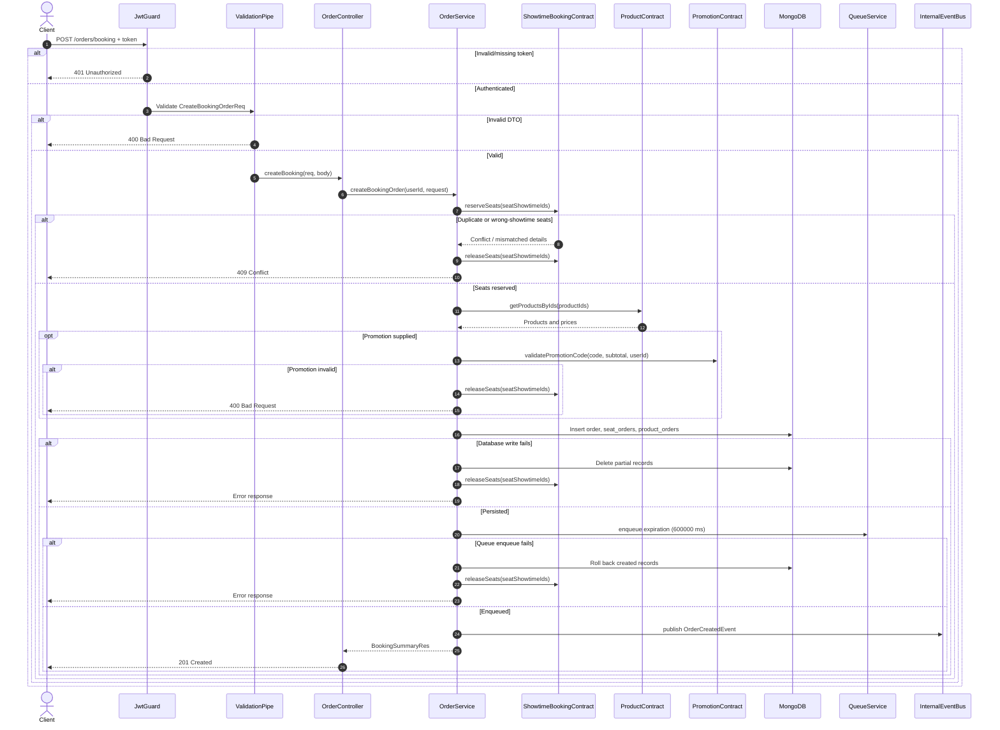
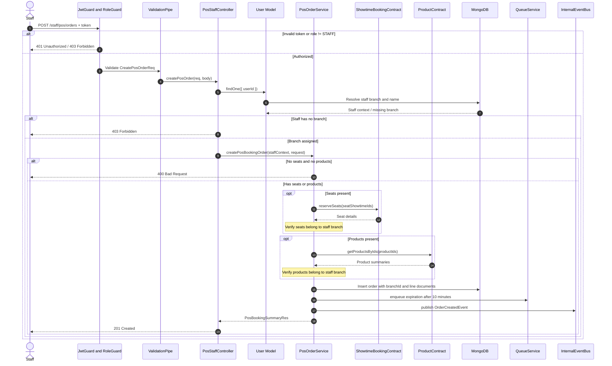
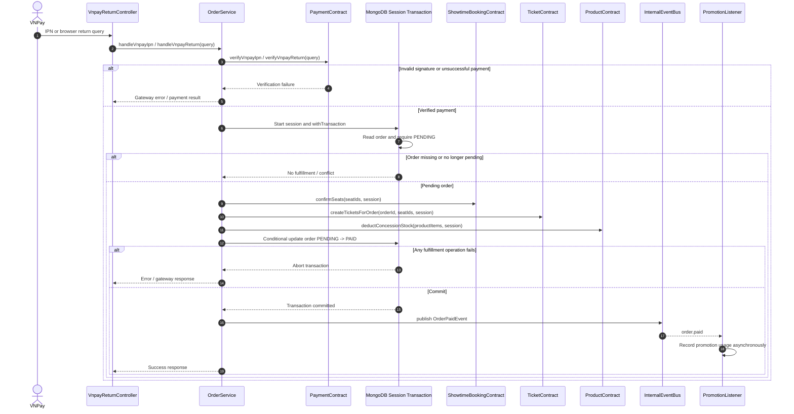
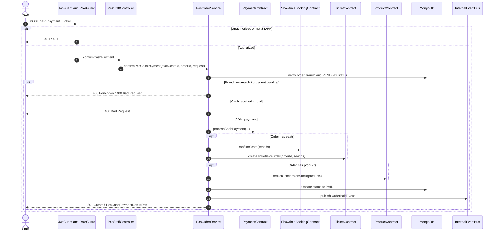
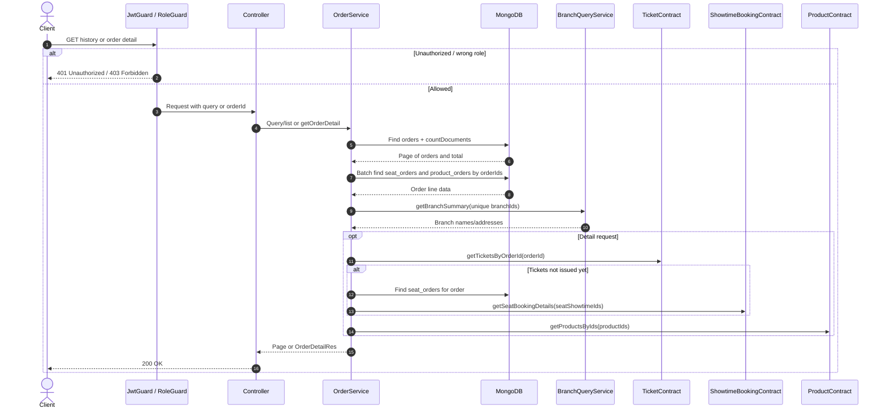

# Software Design Specification — Mục II: Code Designs (Order Module)

- **Tên module:** Order
- **Thư mục:** `backend/src/modules/order`
- **Database:** MongoDB
- **Driver:** Mongoose

## 1. Class Diagram

```mermaid
classDiagram
    class OrderController {
        -orderService: OrderService
        +createBooking(req, body): BookingSummaryRes
        +getMyOrderHistory(req, query): Page~OrderSummaryRes~
        +getBookingSummary(req, orderId): BookingSummaryRes
        +applyPromotion(req, orderId, body): BookingSummaryRes
        +createVnpayPayment(req, orderId, ip): VnpayPaymentUrlDto
        +cancelOrder(req, orderId, body): CancelOrderRes
        +getOrderDetail(req, orderId): OrderDetailRes
    }
    class VnpayReturnController {
        +handleIpn(query): RspCode
        +handleReturn(query, response): Redirect
    }
    class OrderStaffController {
        -orderService: OrderService
        +queryStaffOrders(req, query): Page~OrderSummaryRes~
        +cancelOrder(req, orderId, body): CancelOrderRes
    }
    class OrderAdminController {
        -orderService: OrderService
        +queryAdminOrders(req, query): Page~OrderSummaryRes~
        +cancelOrder(req, orderId, body): CancelOrderRes
    }
    class PosStaffController {
        -posOrderService: PosOrderService
        -userModel: Model~UserDocument~
        +createPosOrder(req, body): PosBookingSummaryRes
        +applyPromotion(req, orderId, body): PosBookingSummaryRes
        +cancelPosOrder(req, orderId, body): Object
        +confirmCashPayment(req, orderId, body): PosCashPaymentResultRes
        +initiateQrPayment(req, orderId, body): PosQrPaymentRes
        +checkPaymentStatus(req, orderId): PosCashPaymentResultRes | PosQrPaymentRes
        +getReceipt(req, orderId): PosReceiptRes
    }
    class OrderService {
        -orderModel: Model~OrderDocument~
        -seatOrderModel: Model~SeatOrderDocument~
        -productOrderModel: Model~ProductOrderDocument~
        -connection: Connection
        -paymentContract: PaymentContract
        -ticketContract: TicketContract
        -productContract: ProductContract
        -promotionContract: PromotionContract
        -showtimeBookingService: ShowtimeBookingContract
        -queueService: QueueService
        -internalEventBus: InternalEventBus
        -branchQueryService: BranchQueryService
        +createBookingOrder(userId, request)
        +createVnpayPayment(userId, orderId, ipAddr)
        +handleVnpayReturn(query)
        +handleVnpayIpn(query)
        +fulfillVnpayOrder(orderId)
        +getBookingSummary(userId, orderId)
        +applyPromotion(userId, orderId, request)
        +expireOrder(orderId)
        +getMyOrderHistory(userId, query)
        +queryStaffOrders(query)
        +queryAdminOrders(query)
        +getOrderDetail(orderId)
        +cancelOrder(orderId, actor, reason)
    }
    class PosOrderService {
        -orderModel: Model~OrderDocument~
        -seatOrderModel: Model~SeatOrderDocument~
        -productOrderModel: Model~ProductOrderDocument~
        -showtimeBookingService: ShowtimeBookingContract
        -ticketContract: TicketContract
        -productContract: ProductContract
        -promotionContract: PromotionContract
        -paymentContract: PaymentContract
        -queueService: QueueService
        -internalEventBus: InternalEventBus
        +createPosBookingOrder(staffContext, request)
        +applyPosPromotion(staffContext, orderId, request)
        +cancelPosOrder(staffContext, orderId, request)
        +confirmPosCashPayment(staffContext, orderId, request)
        +initiatePosQrPayment(staffContext, orderId, request)
        +checkPosPaymentStatus(staffContext, orderId)
        +getPosReceipt(staffContext, orderId)
        -verifyOrderBranch(orderId, branchId)
    }
    class OrderExpirationConsumer {
        +handle(job): Promise~void~
    }
    class Order {
        +orderId: string
        +userId: string
        +promotionId?: string
        +totalAmount: number
        +status: OrderStatus
        +branchId?: string
        +createdAt: Date
        +updatedAt: Date
    }
    class SeatOrder {
        +seatOrderId: string
        +orderId: string
        +seatShowtimeId: string
        +price: number
        +orderAt: Date
    }
    class ProductOrder {
        +productOrderId: string
        +orderId: string
        +productId: string
        +quantity: number
        +unitPrice: number
    }
    class OrderStatus {
        <<enumeration>>
        PENDING
        PAID
        CANCELLED
        EXPIRED
    }
    class ShowtimeBookingContract {
        <<interface>>
        +reserveSeats(ids)
        +releaseSeats(ids)
        +confirmSeats(ids, session)
        +getSeatBookingDetails(ids)
    }
    class TicketContract {
        <<interface>>
        +createTicketsForOrder(data, session)
        +getTicketsByOrderId(orderId)
    }
    class ProductContract {
        <<interface>>
        +getProductsByIds(ids)
        +deductConcessionStock(items, session)
    }
    class PromotionContract {
        <<interface>>
        +validatePromotionCode(params)
        +getPromotionById(id)
        +recordPromotionUsage(params)
    }
    class PaymentContract {
        <<interface>>
        +createVnpayPayment(params)
        +verifyVnpayReturn(query)
        +verifyVnpayIpn(query)
        +processCashPayment(params)
        +generateQrPayment(params)
        +checkPaymentStatus(orderId)
    }
    OrderController ..> OrderService : injects
    OrderStaffController ..> OrderService : injects
    OrderAdminController ..> OrderService : injects
    PosStaffController ..> PosOrderService : injects
    OrderService ..> Order : Mongoose Model
    OrderService ..> SeatOrder : Mongoose Model
    OrderService ..> ProductOrder : Mongoose Model
    PosOrderService ..> Order : Mongoose Model
    PosOrderService ..> SeatOrder : Mongoose Model
    PosOrderService ..> ProductOrder : Mongoose Model
    OrderService ..> ShowtimeBookingContract : injects
    OrderService ..> TicketContract : injects
    OrderService ..> ProductContract : injects
    OrderService ..> PromotionContract : injects
    OrderService ..> PaymentContract : injects
    PosOrderService ..> ShowtimeBookingContract : injects
    PosOrderService ..> TicketContract : injects
    PosOrderService ..> ProductContract : injects
    PosOrderService ..> PromotionContract : injects
    PosOrderService ..> PaymentContract : injects
    OrderExpirationConsumer ..> OrderService : invokes
    Order *-- SeatOrder : by orderId
    Order *-- ProductOrder : by orderId
```



## 2. Class Specifications

### OrderController (`/orders`)
**Class Methods:**

| No | Method | Description |
|---|---|---|
| 01 | `createBooking(req, body: CreateBookingOrderReq): Promise<BookingSummaryRes>` | **Inputs:** authenticated `req`; `@Body()` `showtimeId`, non-empty `seatShowtimeIds`, optional nested `products[]` (`productId`, `quantity >= 1`), optional `promotionCode`. **Outputs:** summary, HTTP 201. **Processing:** `JwtGuard`; extract `userId` from `req.user.userId || req.user.sub`, otherwise `UnauthorizedException`; delegate to `OrderService.createBookingOrder`. |
| 02 | `getMyOrderHistory(req, query: QueryMyOrdersReq): Promise<Page<OrderSummaryRes>>` | **Inputs:** authenticated request; paginated query with optional comma-separated order statuses. **Outputs:** paginated history, HTTP 200. **Processing:** authenticate, resolve user ID, call `getMyOrderHistory`. |
| 03 | `getBookingSummary(req, orderId: string): Promise<BookingSummaryRes>` | **Inputs:** authenticated request and path `orderId`. **Outputs:** summary, HTTP 200. **Processing:** owner-scoped service lookup; unauthorized/forbidden or not found as implemented. |
| 04 | `applyPromotion(req, orderId, body: ApplyPromotionReq): Promise<BookingSummaryRes>` | **Inputs:** authenticated request, path `orderId`, body `promotionCode`. **Outputs:** updated summary, HTTP 201. **Processing:** service checks ownership, `PENDING` status and hold expiry, validates promotion and updates total. |
| 05 | `createVnpayPayment(req, orderId, ip): Promise<VnpayPaymentUrlDto>` | **Inputs:** authenticated request, order ID, `@Ip()` address. **Outputs:** VNPay payment URL, HTTP 201. **Processing:** service verifies ownership and `PENDING`, delegates payment URL generation. |
| 06 | `cancelOrder(req, orderId, body: CancelOrderReq): Promise<CancelOrderRes>` | **Inputs:** authenticated request, order ID, optional reason (max 255). **Outputs:** cancellation response, HTTP 201. **Processing:** actor is USER; service verifies ownership and `PENDING`, releases held seats, marks cancelled, emits event. |
| 07 | `getOrderDetail(req, orderId): Promise<OrderDetailRes>` | **Inputs:** authenticated request and order ID. **Outputs:** detailed order, HTTP 200. **Processing:** authenticate and delegate to service to assemble ticket/seat/product/promotion/branch data. |

### VnpayReturnController (`/payments/vnpay`)
**Class Methods:**

| No | Method | Description |
|---|---|---|
| 01 | `handleIpn(query): Promise<{ RspCode: string; Message: string }>` | **Inputs:** public VNPay query parameters. **Outputs:** gateway acknowledgment, HTTP 200. **Processing:** invokes service verification/fulfillment; no JwtGuard. |
| 02 | `handleReturn(query, response): Promise<void>` | **Inputs:** public VNPay query and Express response. **Outputs:** HTTP 302 redirect to frontend payment-return URL. **Processing:** verifies return and redirects with result parameters. |

### OrderStaffController (`/staff/orders`)
**Class Methods:**

| No | Method | Description |
|---|---|---|
| 01 | `queryStaffOrders(req, query: QueryStaffOrdersReq): Promise<Page<OrderSummaryRes>>` | **Inputs:** STAFF request, pagination, optional status and `YYYY-MM-DD` date. **Outputs:** page, HTTP 200. **Processing:** `JwtGuard`, `RoleGuard(STAFF)`, validation, service query. |
| 02 | `cancelOrder(req, orderId, body: CancelOrderReq): Promise<CancelOrderRes>` | **Inputs:** STAFF request, order ID, optional reason. **Outputs:** cancellation response, HTTP 201. **Processing:** service checks branch ownership and `PENDING`, releases seats and emits cancellation event. |

### OrderAdminController (`/admin/orders`)
**Class Methods:**

| No | Method | Description |
|---|---|---|
| 01 | `queryAdminOrders(req, query: QueryAdminOrdersReq): Promise<Page<OrderSummaryRes>>` | **Inputs:** ADMIN request; page/limit; optional status, userId, fromDate, toDate. **Outputs:** page, HTTP 200. **Processing:** `JwtGuard`, `RoleGuard(ADMIN)`, validate, query service. |
| 02 | `cancelOrder(req, orderId, body: CancelOrderReq): Promise<CancelOrderRes>` | **Inputs:** ADMIN request, order ID, optional reason. **Outputs:** cancellation result, HTTP 201. **Processing:** admin actor may cancel any pending order; service releases seats, updates state and emits event. |

### PosStaffController (`/staff/pos/orders`)
**Class Methods:**

| No | Method | Description |
|---|---|---|
| 01 | `createPosOrder(req, body: CreatePosOrderReq): Promise<PosBookingSummaryRes>` | **Inputs:** STAFF request; optional `showtimeId`, optional unique seat IDs, optional nested products. At least seats or products required. **Outputs:** POS summary, HTTP 201. **Processing:** guard/role; lookup staff branch context; service validates branch ownership for seats/products and creates order. Standalone F&B-only POS order is supported. |
| 02 | `applyPromotion(req, orderId, body: ApplyPromotionReq): Promise<PosBookingSummaryRes>` | **Inputs:** STAFF request, order ID and promotion code. **Outputs:** updated summary, HTTP 201. **Processing:** branch-check order then validate/apply promotion. |
| 03 | `cancelPosOrder(req, orderId, body?: CancelPosOrderReq): Promise<{success:boolean;message:string}>` | **Inputs:** STAFF request, order ID, optional reason. **Outputs:** result, HTTP 201. **Processing:** branch check, require `PENDING`, release seats if any, mark cancelled and emit event. |
| 04 | `confirmCashPayment(req, orderId, body: ProcessPosCashPaymentReq): Promise<PosCashPaymentResultRes>` | **Inputs:** STAFF request; `cashReceived >= 0`. **Outputs:** payment and ticket summary, HTTP 201. **Processing:** branch/status checks, sufficient cash check, cash payment contract, confirm seats, create tickets, deduct F&B stock, mark paid and emit event. |
| 05 | `initiateQrPayment(req, orderId, body: InitiatePosQrPaymentReq): Promise<PosQrPaymentRes>` | **Inputs:** STAFF request, order ID, supported payment method. **Outputs:** QR payload, HTTP 201. **Processing:** branch and pending checks; delegate QR payment creation. |
| 06 | `checkPaymentStatus(req, orderId): Promise<PosCashPaymentResultRes \| PosQrPaymentRes>` | **Inputs:** STAFF request and order ID. **Outputs:** current POS payment state, HTTP 200. **Processing:** branch check; if paid return result; otherwise poll payment provider. On success fulfill seats/tickets/stock/order and emit paid event. |
| 07 | `getReceipt(req, orderId): Promise<PosReceiptRes>` | **Inputs:** STAFF request and order ID. **Outputs:** receipt, HTTP 200. **Processing:** branch check; order must be paid; assemble tickets, products, payment and branch/staff fields for 80mm receipt. |

### OrderService
**Dependencies:** Mongoose models `Order`, `SeatOrder`, `ProductOrder`, Mongo connection; payment, ticket, product, promotion, showtime-booking contracts; queue, internal event bus, branch query service.

| Method | Description |
|---|---|
| `createBookingOrder(userId, request)` | Rejects duplicate seat IDs; reserves seats; verifies all seats belong to requested showtime; loads product prices; validates optional promotion; creates order and seat/product lines. On errors deletes partial records and releases seats. Enqueues expiration after `ORDER_HOLD_TIMEOUT_MS = 600_000`; queue failure rolls back stored data and seat reservation. Emits `OrderCreatedEvent`. |
| `createVnpayPayment(userId, orderId, ipAddr)` | Finds order; checks ownership and `PENDING`; delegates VNPay payment creation. Throws not found/forbidden/bad request for failed preconditions. |
| `handleVnpayReturn(query)` / `handleVnpayIpn(query)` | Verifies gateway signature through payment contract, then invokes payment fulfillment as appropriate. IPN returns gateway response; browser return redirects through controller. |
| `fulfillVnpayOrder(orderId)` | Runs Mongo session transaction; ensures order remains pending; confirms seats, creates tickets, deducts concession stock, conditionally changes status to paid; emits `OrderPaidEvent` after successful fulfillment. |
| `getBookingSummary(userId, orderId)` | Enforces order ownership; combines seat booking details, products, promotion and remaining hold seconds into summary. |
| `applyPromotion(userId, orderId, request)` | Checks owner, pending status and 10-minute hold; calculates eligible subtotal, validates promotion, updates `promotionId` and total. Invalid promotion/expired order produces business error. |
| `expireOrder(orderId)` | Atomic transition `PENDING -> EXPIRED`; only when transition succeeds loads seat IDs, releases reservations and emits expiration event. |
| `getMyOrderHistory(userId, query)` | Queries orders filtered by user/status; delegates pagination/enrichment. |
| `queryStaffOrders(query)` | Queries staff-visible orders by optional status/date and branch context as implemented; returns paginated summaries. |
| `queryAdminOrders(query)` | Builds admin filters from status/user/date range and paginates. |
| `paginateOrders(filter, page, limit)` | Parallel order page and count query, loads seat/product lines in batches for order IDs, enriches unique branch IDs using `BranchQueryService`, returns `Page.from(...)`. |
| `getOrderDetail(orderId)` | Loads order; gets issued tickets or falls back to held-seat/showtime details before issuance; enriches branch and F&B product data, promotion summary and returns detail. |
| `cancelOrder(orderId, actor, reason)` | Requires pending order. USER must own it; STAFF must match order branch; ADMIN unrestricted. Releases associated seats, marks cancelled and publishes `OrderCancelledEvent`. Throws `NotFoundException`, `ForbiddenException`, `BadRequestException` or `ConflictException` per failed checks. |

### PosOrderService
**Dependencies:** Mongoose models `Order`, `SeatOrder`, `ProductOrder`; showtime, ticket, product, promotion, payment contracts; queue and event bus.

| Method | Description |
|---|---|
| `createPosBookingOrder(staffContext, request)` | Accepts seats, F&B, or both; rejects empty order. Validates seat/product branch against staff branch; writes order with branch metadata and line items; queues expiration; emits created event. Supports standalone concession sales. |
| `applyPosPromotion(staffContext, orderId, request)` | Verifies order branch; applies valid promotion to pending order and saves total. |
| `cancelPosOrder(staffContext, orderId, request)` | Verifies branch and pending status; marks cancelled, releases seats when present and emits cancellation event. |
| `confirmPosCashPayment(staffContext, orderId, request)` | Verifies branch/pending, checks received cash >= total; processes cash payment; confirms seats when any, creates tickets when any, deducts F&B stock; marks paid and emits event. |
| `initiatePosQrPayment(staffContext, orderId, request)` | Verifies branch and pending; asks payment contract to generate QR payment. |
| `checkPosPaymentStatus(staffContext, orderId)` | Returns paid result immediately if already paid; otherwise queries payment provider. On provider success performs fulfillment and emits paid event. |
| `getPosReceipt(staffContext, orderId)` | Verifies branch and PAID status; collects payment/tickets/products/branch/staff information for thermal receipt. |
| `verifyOrderBranch(orderId, branchId)` | Ensures order belongs to staff branch. For legacy orders lacking branchId, resolves branch from seat order and showtime booking details; mismatch throws `ForbiddenException`. |

### OrderExpirationConsumer
**Class Methods:**

| No | Method | Description |
|---|---|---|
| 01 | `handle(job: Job<{orderId: string}>): Promise<void>` | **Inputs:** delayed queue job containing order ID. **Outputs:** void. **Processing:** consumer invokes `OrderService.expireOrder`; job is scheduled with 10-minute delay. |

## 3. Sequence Diagrams

### 3.1 Online booking creation (`POST /orders/booking`)



### 3.2 POS order creation, including standalone F&B (`POST /staff/pos/orders`)



### 3.3 VNPay payment fulfillment (`/payments/vnpay/ipn` or return)



### 3.4 POS cash payment (`POST /staff/pos/orders/:orderId/pay/cash`)



### 3.5 Order cancellation

```mermaid
sequenceDiagram
    autonumber
    actor Actor as User, Staff, or Admin
    participant G as JwtGuard and RoleGuard
    participant C as Relevant Order Controller
    participant S as OrderService or PosOrderService
    participant DB as MongoDB
    participant SB as ShowtimeBookingContract
    participant E as InternalEventBus

    Actor->>G: POST order cancellation + token
    alt Invalid authentication or role
        G-->>Actor: 401 Unauthorized / 403 Forbidden
    else Authorized
        G->>C: cancelOrder(orderId, reason)
        C->>S: cancel order for actor/context
        S->>DB: Find order
        alt Order not found
            S-->>Actor: 404 Not Found
        else Ownership/branch check fails
            S-->>Actor: 403 Forbidden
        else Status is not PENDING
            S-->>Actor: 400 Bad Request / Conflict
        else Pending and authorized
            S->>DB: Find seat_orders by orderId
            DB-->>S: Seat IDs (possibly empty for standalone POS)
            opt Seats exist
                S->>SB: releaseSeats(seatShowtimeIds)
            end
            S->>DB: Update order status to CANCELLED
            S->>E: publish OrderCancelledEvent
            S-->>Actor: 201 Created CancelOrderRes
        end
    end
```

### 3.6 Paginated history and detail lookup



## 4. Database Queries

MongoDB/Mongoose is the actual persistence layer. SQL below expresses relational equivalents for documentation and does not imply SQL tables exist. Values are placeholders. Cross-module calls (payment, ticket, showtime, product, promotion, branch) are not Order-module database queries.

### 4.1 Create order and line items

```javascript
db.orders.insertOne({
  orderId: "<orderId>", userId: "<userId>", branchId: "<branchId>",
  promotionId: "<promotionId-or-null>", totalAmount: <amount>, status: "PENDING",
  createdAt: new Date(), updatedAt: new Date()
});
db.seat_orders.insertMany(<seatOrderDocuments>);
db.product_orders.insertMany(<productOrderDocuments>);
```

```sql
INSERT INTO orders (order_id, user_id, branch_id, promotion_id, total_amount, status, created_at, updated_at)
VALUES (:orderId, :userId, :branchId, :promotionId, :amount, 'PENDING', CURRENT_TIMESTAMP, CURRENT_TIMESTAMP);
INSERT INTO seat_orders (seat_order_id, order_id, seat_showtime_id, price, order_at, created_at, updated_at)
VALUES (:seatOrderId, :orderId, :seatShowtimeId, :price, CURRENT_TIMESTAMP, CURRENT_TIMESTAMP, CURRENT_TIMESTAMP);
INSERT INTO product_orders (product_order_id, order_id, product_id, quantity, unit_price, created_at, updated_at)
VALUES (:productOrderId, :orderId, :productId, :quantity, :unitPrice, CURRENT_TIMESTAMP, CURRENT_TIMESTAMP);
```

### 4.2 Roll back partial booking records

```javascript
db.orders.deleteOne({ orderId: "<orderId>" });
db.seat_orders.deleteMany({ orderId: "<orderId>" });
db.product_orders.deleteMany({ orderId: "<orderId>" });
```

```sql
DELETE FROM seat_orders WHERE order_id = :orderId;
DELETE FROM product_orders WHERE order_id = :orderId;
DELETE FROM orders WHERE order_id = :orderId;
```

### 4.3 Find order and associated lines

```javascript
db.orders.findOne({ orderId: "<orderId>" });
db.seat_orders.find({ orderId: "<orderId>" });
db.product_orders.find({ orderId: "<orderId>" });
```

```sql
SELECT * FROM orders WHERE order_id = :orderId LIMIT 1;
SELECT * FROM seat_orders WHERE order_id = :orderId;
SELECT * FROM product_orders WHERE order_id = :orderId;
```

### 4.4 Apply promotion to a pending order

```javascript
db.orders.updateOne(
  { orderId: "<orderId>", userId: "<userId>", status: "PENDING" },
  { $set: { promotionId: "<promotionId>", totalAmount: <newAmount>, updatedAt: new Date() } }
);
```

```sql
UPDATE orders
SET promotion_id = :promotionId, total_amount = :newAmount, updated_at = CURRENT_TIMESTAMP
WHERE order_id = :orderId AND user_id = :userId AND status = 'PENDING';
```

### 4.5 Fulfill paid order (conditional state transition)

```javascript
db.orders.updateOne(
  { orderId: "<orderId>", status: "PENDING" },
  { $set: { status: "PAID", updatedAt: new Date() } },
  { session: <session> }
);
```

```sql
UPDATE orders SET status = 'PAID', updated_at = CURRENT_TIMESTAMP
WHERE order_id = :orderId AND status = 'PENDING';
```

### 4.6 Expire pending order

```javascript
db.orders.findOneAndUpdate(
  { orderId: "<orderId>", status: "PENDING" },
  { $set: { status: "EXPIRED", updatedAt: new Date() } },
  { returnDocument: "after" }
);
```

```sql
UPDATE orders SET status = 'EXPIRED', updated_at = CURRENT_TIMESTAMP
WHERE order_id = :orderId AND status = 'PENDING'
RETURNING *;
```

### 4.7 Cancel order

```javascript
db.orders.findOne({ orderId: "<orderId>" });
db.seat_orders.find({ orderId: "<orderId>" }, { seatShowtimeId: 1 });
db.orders.updateOne(
  { orderId: "<orderId>" },
  { $set: { status: "CANCELLED", updatedAt: new Date() } }
);
```

```sql
SELECT * FROM orders WHERE order_id = :orderId LIMIT 1;
SELECT seat_showtime_id FROM seat_orders WHERE order_id = :orderId;
UPDATE orders SET status = 'CANCELLED', updated_at = CURRENT_TIMESTAMP
WHERE order_id = :orderId;
```

### 4.8 Paginated order query and count

```javascript
db.orders.find({ userId: "<userId>", status: { $in: ["PENDING", "PAID"] }, createdAt: { $gte: <from>, $lte: <to> } })
  .sort({ createdAt: -1 }).skip(<offset>).limit(<limit>);
db.orders.countDocuments({ userId: "<userId>", status: { $in: ["PENDING", "PAID"] }, createdAt: { $gte: <from>, $lte: <to> } });
```

```sql
SELECT * FROM orders
WHERE (:userId IS NULL OR user_id = :userId)
  AND (:statuses IS NULL OR status IN (:statuses))
  AND (:fromDate IS NULL OR created_at >= :fromDate)
  AND (:toDate IS NULL OR created_at <= :toDate)
ORDER BY created_at DESC LIMIT :limit OFFSET :offset;
SELECT COUNT(*) FROM orders
WHERE (:userId IS NULL OR user_id = :userId)
  AND (:statuses IS NULL OR status IN (:statuses))
  AND (:fromDate IS NULL OR created_at >= :fromDate)
  AND (:toDate IS NULL OR created_at <= :toDate);
```

### 4.9 Batch load seat and product lines for page

```javascript
db.seat_orders.find({ orderId: { $in: ["<orderId1>", "<orderId2>"] } });
db.product_orders.find({ orderId: { $in: ["<orderId1>", "<orderId2>"] } });
```

```sql
SELECT * FROM seat_orders WHERE order_id IN (:orderIds);
SELECT * FROM product_orders WHERE order_id IN (:orderIds);
```

### 4.10 POS staff context lookup

```javascript
db.users.findOne({ userId: "<staffUserId>" });
```

```sql
SELECT * FROM users WHERE user_id = :staffUserId LIMIT 1;
```

## Schema, DTO and business-rule notes

- Collections: `orders`, `seat_orders`, `product_orders`; all use Mongoose timestamps.
- `Order` stores optional `branchId` to support branch reporting and POS scoping. Online booking derives it from reserved seat details; POS uses staff branch.
- POS creation accepts seat-only, product-only, or combined orders; empty order rejected.
- Order states: `PENDING`, `PAID`, `CANCELLED`, `EXPIRED`.
- Online and POS orders schedule a 10-minute expiration job; online order path explicitly rolls back stored order/lines and seat reservation if queue scheduling fails.
- Cancellation is permitted only for pending orders and checks actor ownership/branch according to role; seats are released if present.
- Online VNPay fulfillment uses a Mongo transaction for seat confirmation, ticket issuance, stock deduction and order state update. POS cash/QR fulfillment follows service flow; transaction behavior must not be assumed beyond implementation.
- Order-paid event can trigger Promotion module's async usage recording listener.
