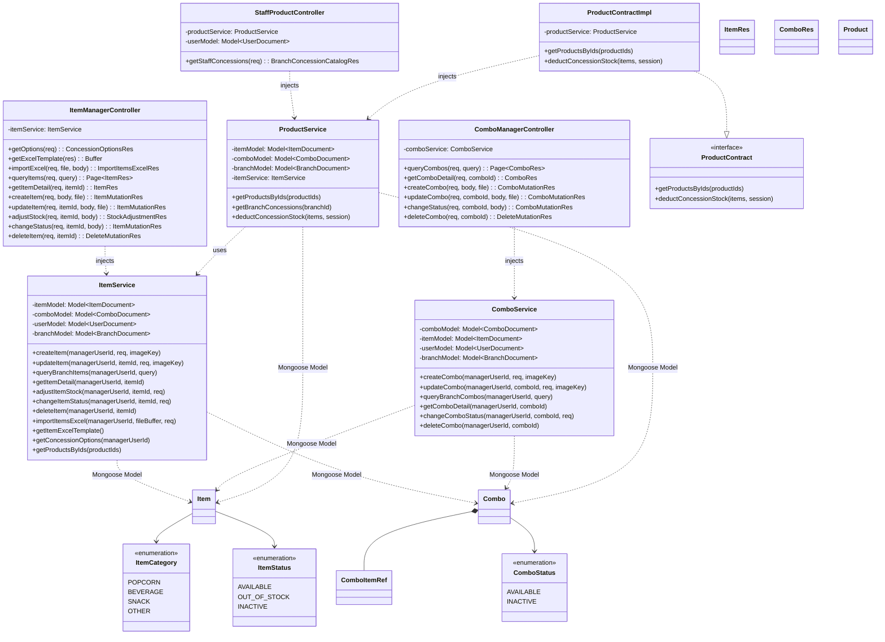
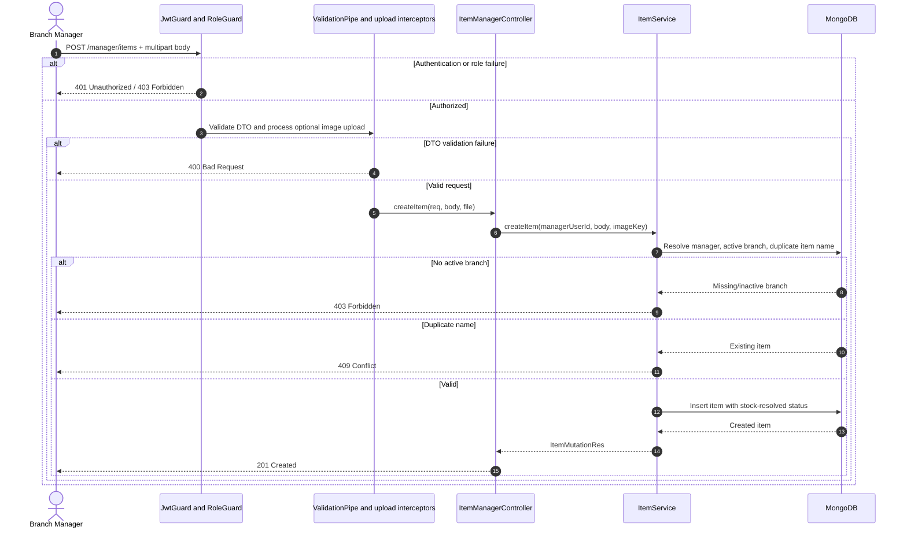

# Software Design Specification — Mục II: Code Designs (Product Module)

- **Tên module:** Product
- **Thư mục:** `backend/src/modules/product`
- **Database:** MongoDB
- **Driver:** Mongoose

## 1. Class Diagram



## 2. Class Specifications

### ItemManagerController
**Class Methods:**

| No | Method | Description |
|---|---|---|
| 01 | `getOptions(req): Promise<ConcessionOptionsRes>` | **Inputs:** authenticated request, user identity. **Outputs:** concession metadata/options, HTTP 200. **Processing:** `JwtGuard` + `RoleGuard` require `BRANCHMANAGER`; `ValidationPipe` transforms/whitelists; delegates to `ItemService.getConcessionOptions`. Missing/inactive branch causes 403. |
| 02 | `getExcelTemplate(res): void` | **Inputs:** Express response. **Outputs:** downloadable `.xlsx` template, HTTP 200. **Processing:** delegates template generation to `ItemService.getItemExcelTemplate`, sets attachment filename `concession-item-template.xlsx`. |
| 03 | `importExcel(req, file, body): Promise<ImportItemsExcelRes>` | **Inputs:** authenticated request, uploaded `file`, `ImportItemsExcelReq.stockMode` (`OVERWRITE` or `ACCUMULATE`). **Outputs:** row counts and row errors, HTTP 201. **Processing:** guard and validation; file interceptor obtains upload; service parses workbook, validates rows, upserts/imports branch items. Invalid/empty workbook causes 400. |
| 04 | `queryItems(req, query): Promise<Page<ItemRes>>` | **Inputs:** authenticated request and `QueryBranchItemsReq` (`page`, `limit`, `search`, `category`, `status`, `lowStockOnly`). **Outputs:** paginated item results, HTTP 200. **Processing:** manager branch is resolved; service filters and pages items. |
| 05 | `getItemDetail(req, itemId): Promise<ItemRes>` | **Inputs:** authenticated request and path `itemId`. **Outputs:** item response, HTTP 200. **Processing:** resolves manager branch and scopes lookup to that branch; missing item causes 404. |
| 06 | `createItem(req, body, file): Promise<ItemMutationRes>` | **Inputs:** authenticated request, multipart `CreateItemReq`, optional image file. **Outputs:** created item response, HTTP 201. **Processing:** validation and storage interceptors run; service validates manager branch, checks case-insensitive name uniqueness, resolves stock-derived status, creates item. Duplicate name causes 409; missing/inactive branch causes 403. |
| 07 | `updateItem(req, itemId, body, file): Promise<ItemMutationRes>` | **Inputs:** authenticated request, `itemId`, multipart `UpdateItemReq`, optional image. **Outputs:** updated item response, HTTP 200. **Processing:** service scopes item to manager branch; item missing causes 404; renamed item checked for duplicates (409); stock/status consistency is resolved before save. |
| 08 | `adjustStock(req, itemId, body): Promise<StockAdjustmentRes>` | **Inputs:** authenticated request, `itemId`, `AdjustItemStockReq` (`adjustmentType`: `ADD`/`SET`/`SUBTRACT`; non-negative integer quantity; optional reason). **Outputs:** previous/current stock and status, HTTP 200. **Processing:** branch/item lookup; calculate stock; negative result causes 400; save and resolve `AVAILABLE`/`OUT_OF_STOCK` while preserving `INACTIVE`. |
| 09 | `changeStatus(req, itemId, body): Promise<ItemMutationRes>` | **Inputs:** authenticated request, `itemId`, `ChangeItemStatusReq.status`. **Outputs:** item response, HTTP 200. **Processing:** branch-scoped lookup; resolve requested status against stock. Item with zero stock cannot become `AVAILABLE`; missing item causes 404. |
| 10 | `deleteItem(req, itemId): Promise<DeleteMutationRes>` | **Inputs:** authenticated request and `itemId`. **Outputs:** deletion result, HTTP 200. **Processing:** resolves manager branch, deletes only matching `{ itemId, branchId }`; result follows implementation response. |

### ComboManagerController
**Class Methods:**

| No | Method | Description |
|---|---|---|
| 01 | `queryCombos(req, query): Promise<Page<ComboRes>>` | **Inputs:** authenticated request, paginated `QueryBranchCombosReq` (`search`, `status`). **Outputs:** paginated combo responses, HTTP 200. **Processing:** manager guard/role and DTO validation; service scopes query to manager branch and computes virtual availability. |
| 02 | `getComboDetail(req, comboId): Promise<ComboRes>` | **Inputs:** authenticated request and `comboId`. **Outputs:** combo details including constituent item data and virtual stock, HTTP 200. **Processing:** branch-scoped lookup; missing combo causes 404. |
| 03 | `createCombo(req, body, file): Promise<ComboMutationRes>` | **Inputs:** authenticated request, `CreateComboReq` (name, price, status, optional image/description, non-empty list of item references with positive quantities), optional image file. `items` may arrive as JSON string in multipart data. **Outputs:** created combo, HTTP 201. **Processing:** validate branch, unique name, unique child IDs, existence and same-branch ownership of all items; persist combo. Invalid child references or duplicate IDs cause 400. |
| 04 | `updateCombo(req, comboId, body, file): Promise<ComboMutationRes>` | **Inputs:** authenticated request, `comboId`, optional fields of `UpdateComboReq`, optional image. **Outputs:** updated combo, HTTP 200. **Processing:** branch-scoped lookup; validate unique name/child IDs and item ownership when provided; recompute response-derived availability. Missing combo causes 404. |
| 05 | `changeStatus(req, comboId, body): Promise<ComboMutationRes>` | **Inputs:** authenticated request, `comboId`, `ChangeComboStatusReq.status`. **Outputs:** updated combo, HTTP 200. **Processing:** resolve manager branch, update status of matching combo; response computes availability from current child inventory. |
| 06 | `deleteCombo(req, comboId): Promise<DeleteMutationRes>` | **Inputs:** authenticated request and `comboId`. **Outputs:** deletion result, HTTP 200. **Processing:** branch-scoped deletion; result follows implementation response. |

### StaffProductController
**Class Methods:**

| No | Method | Description |
|---|---|---|
| 01 | `getStaffConcessions(req): Promise<BranchConcessionCatalogRes>` | **Inputs:** authenticated staff request. **Outputs:** available branch items and combos, HTTP 200. **Processing:** `JwtGuard` and `RoleGuard` require `STAFF`; controller resolves staff branch; absent branch causes forbidden response; delegates to `ProductService.getBranchConcessions(branchId)`. Inactive branch is rejected by service. |

### ItemService
**Dependencies:** Mongoose models for `Item`, `Combo`, `User`, `Branch`.

| Method | Description |
|---|---|
| `validateManagerBranch(managerUserId)` | Reads manager and branch. Missing manager/branch assignment or inactive branch causes `ForbiddenException(NO_BRANCH)`. |
| `createItem(managerUserId, req, imageKey)` | Resolves active branch; trims name; checks case-insensitive duplicate name in branch (`ConflictException`); computes status from stock, preserving `INACTIVE`; creates item. |
| `updateItem(managerUserId, itemId, req, imageKey)` | Finds item scoped by `itemId` and branch (`NotFoundException`); checks renamed item uniqueness excluding current item; applies provided fields and stock-status rule; persists and maps response. |
| `queryBranchItems(managerUserId, query)` | Resolves branch; filters items by branch and optional search/category/status/low-stock conditions; sorts/pages; returns `Page<ItemRes>`. |
| `getItemDetail(managerUserId, itemId)` | Resolves branch and queries matching item; missing result causes `NotFoundException`. |
| `adjustItemStock(managerUserId, itemId, req)` | Applies `ADD`, `SET`, or `SUBTRACT`; rejects negative resulting stock with `BadRequestException(STOCK_CANNOT_BE_NEGATIVE)`; reconciles status and saves. |
| `changeItemStatus(managerUserId, itemId, req)` | Finds branch item; uses `resolveItemStockStatus`; zero stock prevents `AVAILABLE`; saves result. |
| `deleteItem(managerUserId, itemId)` | Deletes by `{ itemId, branchId }`. |
| `importItemsExcel(managerUserId, fileBuffer, req)` | Parses Excel workbook; invalid or empty input causes 400. Parses localized category/size and numeric cells; finds items case-insensitively by name within branch. Existing items are updated with stock `OVERWRITE` or `ACCUMULATE`; new items receive UUID. Per-row failures are collected in response rather than aborting all rows. |
| `getItemExcelTemplate()` | Produces downloadable Excel template. |
| `getConcessionOptions(managerUserId)` | Returns branch metadata, enum options and eligible items for combo creation. |
| `getProductsByIds(productIds)` | Queries items, then combos for unresolved IDs; returns product summary map. |

### ComboService
**Dependencies:** Mongoose models for `Combo`, `Item`, `User`, `Branch`.

| Method | Description |
|---|---|
| `resolveManagerBranchId(managerUserId)` | Validates branch manager assignment and active branch; otherwise forbidden. |
| `validateUniqueItemIds(itemIds)` | Rejects duplicate item IDs in a combo with `BadRequestException`. |
| `fetchAndValidateBranchItems(branchId, itemIds)` | Queries items matching IDs and branch; if count differs, rejects invalid or foreign-branch item references with `BadRequestException`. |
| `mapToComboRes(combo, itemsMap)` | Computes `originalTotalPrice = Σ(unitPrice × quantity)`, each child stock limit `floor(stockQuantity / ref.quantity)` only for available items, `availableStock = min(stock limits)`, `isAvailable` from combo status and child availability, and `savingsAmount = max(0, originalTotalPrice - combo.price)`. |
| `createCombo(managerUserId, req, imageKey)` | Validates manager branch, unique combo name and item IDs, verifies all child items belong to branch, creates combo and returns enriched response. |
| `updateCombo(managerUserId, comboId, req, imageKey)` | Finds branch-scoped combo; validates updates and child references; persists and returns enriched response. |
| `queryBranchCombos(managerUserId, query)` | Queries branch combos with optional filters/pagination; fetches child items and maps virtual stock and pricing. |
| `getComboDetail(managerUserId, comboId)` | Fetches branch-scoped combo and child items; maps detail or raises not found. |
| `changeComboStatus(managerUserId, comboId, req)` | Updates status for branch-scoped combo and returns enriched result. |
| `deleteCombo(managerUserId, comboId)` | Deletes combo scoped to manager branch. |

### ProductService
**Dependencies:** Mongoose models for `Item`, `Combo`, `Branch`; `ItemService`.

| Method | Description |
|---|---|
| `getProductsByIds(productIds)` | Resolves requested IDs across items and combos and returns product summaries. |
| `getBranchConcessions(branchId)` | Requires active branch; queries available in-stock items and available combos; loads combo child items, computes virtual stock and returns sellable catalog. |
| `deductConcessionStock(items, session)` | Expands combo quantities into base item quantities; aggregates by item ID; atomically decrements each item using `stockQuantity >= requiredQty` and supplied session. If update fails, looks up product name and throws `ConflictException` for insufficient stock. When resulting stock reaches zero, changes `AVAILABLE` to `OUT_OF_STOCK`. |

### ProductContractImpl
**Class Methods:**

| No | Method | Description |
|---|---|---|
| 01 | `getProductsByIds(productIds)` | Delegates product lookup to `ProductService.getProductsByIds`. |
| 02 | `deductConcessionStock(items, session)` | Delegates stock deduction to `ProductService.deductConcessionStock`, preserving the caller's Mongoose session. |

## 3. Sequence Diagrams

### 3.1 Adjust item stock — `PATCH /manager/items/:itemId/stock`

```mermaid
sequenceDiagram
    autonumber
    actor Mgr as Branch Manager
    participant G as JwtGuard and RoleGuard
    participant VP as ValidationPipe
    participant C as ItemManagerController
    participant S as ItemService
    participant U as User Model
    participant B as Branch Model
    participant I as Item Model
    participant DB as MongoDB

    Mgr->>G: PATCH /manager/items/:itemId/stock + token
    alt Invalid token
        G-->>Mgr: 401 Unauthorized
    else Role is not BRANCHMANAGER
        G-->>Mgr: 403 Forbidden
    else Authorized
        G->>VP: Forward request
        alt Invalid DTO
            VP-->>Mgr: 400 Bad Request
        else Valid DTO
            VP->>C: adjustStock(req, itemId, body)
            C->>S: adjustItemStock(userId, itemId, body)
            S->>U: findOne({ userId })
            U->>DB: Read manager
            DB-->>U: Manager with branchId / null
            U-->>S: Manager result
            alt Missing branch assignment or inactive branch
                S-->>Mgr: 403 Forbidden (NO_BRANCH)
            else Branch assigned
                S->>B: findOne({ branchId })
                B->>DB: Read branch
                DB-->>B: Branch status
                B-->>S: Branch
                S->>I: findOne({ itemId, branchId })
                I->>DB: Read item
                DB-->>I: Item / null
                I-->>S: Item result
                alt Item not found
                    S-->>Mgr: 404 Not Found
                else Found
                    Note over S: Compute ADD / SET / SUBTRACT; reject negative result
                    alt SUBTRACT makes stock negative
                        S-->>Mgr: 400 Bad Request (STOCK_CANNOT_BE_NEGATIVE)
                    else Valid stock
                        S->>I: Save adjusted stock and resolved status
                        I->>DB: Update item document
                        DB-->>I: Saved item
                        I-->>S: Saved item
                        S-->>C: StockAdjustmentRes
                        C-->>Mgr: 200 OK
                    end
                end
            end
        end
    end
```

### 3.2 Deduct item/combo inventory during order processing

```mermaid
sequenceDiagram
    autonumber
    participant O as Order or POS Service
    participant PC as ProductContractImpl
    participant P as ProductService
    participant I as Item Model
    participant C as Combo Model
    participant DB as MongoDB

    O->>PC: deductConcessionStock(items, session)
    PC->>P: deductConcessionStock(items, session)
    P->>I: Find item products by requested IDs
    I->>DB: Query items
    DB-->>I: Matching items
    P->>C: Find combo products by requested IDs
    C->>DB: Query combos and component references
    DB-->>C: Matching combos
    Note over P: Expand combos and aggregate required quantities per base item
    loop Each item and required quantity
        P->>I: findOneAndUpdate(itemId, stockQuantity >= qty, decrement, session)
        I->>DB: Atomic conditional decrement
        alt Stock insufficient or item missing
            DB-->>I: No matching updated document
            I-->>P: null
            P->>I: findOne({ itemId }) for product name
            I->>DB: Read item
            DB-->>I: Item / null
            P-->>O: 409 Conflict (insufficient stock)
            Note over O: Caller aborts transaction; transaction rollback depends on caller
        else Decrement succeeded
            DB-->>I: Updated item
            I-->>P: Updated document
            opt New stock is zero and status was AVAILABLE
                P->>I: Update status to OUT_OF_STOCK (session)
                I->>DB: Update item
                DB-->>I: Acknowledged
            end
        end
    end
    P-->>PC: void
    PC-->>O: void
```

### 3.3 Create item — `POST /manager/items`



### 3.4 Read staff concession catalog — `GET /staff/products`

```mermaid
sequenceDiagram
    autonumber
    actor Staff
    participant G as JwtGuard and RoleGuard
    participant C as StaffProductController
    participant U as User Model
    participant P as ProductService
    participant B as Branch Model
    participant I as Item Model
    participant Co as Combo Model
    participant DB as MongoDB

    Staff->>G: GET /staff/products + token
    alt Invalid token or non-STAFF role
        G-->>Staff: 401 Unauthorized / 403 Forbidden
    else Authorized
        G->>C: getStaffConcessions(req)
        C->>U: Resolve staff branch
        U->>DB: findOne({ userId })
        DB-->>U: Staff branchId
        U-->>C: branchId
        C->>P: getBranchConcessions(branchId)
        P->>B: Verify active branch
        B->>DB: findOne({ branchId })
        DB-->>B: Branch status
        alt Branch missing or inactive
            P-->>Staff: Forbidden response
        else Active branch
            P->>I: Find AVAILABLE items with stockQuantity > 0
            I->>DB: Query and sort items by name
            DB-->>I: Items
            P->>Co: Find AVAILABLE combos and component items
            Co->>DB: Query combos
            DB-->>Co: Combos
            Note over P: Compute virtual stock; include only sellable combos
            P-->>Staff: 200 OK BranchConcessionCatalogRes
        end
    end
```

## 4. Database Queries

MongoDB/Mongoose is the actual persistence layer. SQL snippets below express equivalent relational operations only; they do not imply SQL tables exist. Identifiers and example values are illustrative. Queries with parameter-dependent filters are shown in generalized form.

### 4.1 Item manager/branch resolution

```javascript
db.users.findOne({ userId: "<managerUserId>" });
db.branches.findOne({ branchId: "<branchId>" });
```

```sql
SELECT * FROM users WHERE user_id = :managerUserId LIMIT 1;
SELECT * FROM branches WHERE branch_id = :branchId LIMIT 1;
```

### 4.2 Create item; duplicate-name lookup

```javascript
db.items.findOne({
  branchId: "<branchId>",
  name: { $regex: "^<escapedName>$", $options: "i" }
});
db.items.insertOne({
  itemId: "<uuid>", branchId: "<branchId>", name: "<name>",
  category: "<category>", size: "<size-or-null>", price: 0,
  costPrice: 0, stockQuantity: 0, lowStockThreshold: 10,
  status: "OUT_OF_STOCK", imageKey: null, description: null,
  createdAt: ISODate("<timestamp>"), updatedAt: ISODate("<timestamp>")
});
```

```sql
SELECT * FROM items
WHERE branch_id = :branchId AND LOWER(name) = LOWER(:name)
LIMIT 1;
INSERT INTO items (item_id, branch_id, name, category, size, price, cost_price,
                   stock_quantity, low_stock_threshold, status, image_key,
                   description, created_at, updated_at)
VALUES (:itemId, :branchId, :name, :category, :size, :price, :costPrice,
        :stockQuantity, :lowStockThreshold, :status, :imageKey,
        :description, NOW(), NOW());
```

### 4.3 Query, filter and paginate items

```javascript
db.items.find({
  branchId: "<branchId>",
  // Optional filters: name regex, category, status, low stock expression
  $expr: { $lte: ["$stockQuantity", "$lowStockThreshold"] }
}).sort({ createdAt: -1 }).skip(<offset>).limit(<limit>);
db.items.countDocuments({ branchId: "<branchId>" /* same filters */ });
```

```sql
SELECT * FROM items
WHERE branch_id = :branchId
  AND (:search IS NULL OR name ILIKE '%' || :search || '%')
  AND (:category IS NULL OR category = :category)
  AND (:status IS NULL OR status = :status)
  AND (:lowStockOnly = FALSE OR
       (status <> 'INACTIVE' AND stock_quantity <= low_stock_threshold))
ORDER BY created_at DESC
LIMIT :limit OFFSET :offset;
SELECT COUNT(*) FROM items
WHERE branch_id = :branchId
  AND (:search IS NULL OR name ILIKE '%' || :search || '%')
  AND (:category IS NULL OR category = :category)
  AND (:status IS NULL OR status = :status)
  AND (:lowStockOnly = FALSE OR
       (status <> 'INACTIVE' AND stock_quantity <= low_stock_threshold));
```

### 4.4 Get item detail and update item

```javascript
db.items.findOne({ itemId: "<itemId>", branchId: "<branchId>" });
db.items.findOneAndUpdate(
  { itemId: "<itemId>", branchId: "<branchId>" },
  { $set: { name: "<name>", price: <price>, updatedAt: ISODate("<timestamp>") } },
  { returnDocument: "after" }
);
```

```sql
SELECT * FROM items WHERE item_id = :itemId AND branch_id = :branchId LIMIT 1;
UPDATE items SET name = :name, price = :price, updated_at = NOW()
WHERE item_id = :itemId AND branch_id = :branchId
RETURNING *;
```

### 4.5 Adjust stock / change item status / delete item

```javascript
db.items.findOne({ itemId: "<itemId>", branchId: "<branchId>" });
db.items.updateOne(
  { itemId: "<itemId>", branchId: "<branchId>" },
  { $set: { stockQuantity: <nextStock>, status: "<resolvedStatus>" } }
);
db.items.deleteOne({ itemId: "<itemId>", branchId: "<branchId>" });
```

```sql
SELECT * FROM items WHERE item_id = :itemId AND branch_id = :branchId LIMIT 1;
UPDATE items SET stock_quantity = :nextStock, status = :resolvedStatus, updated_at = NOW()
WHERE item_id = :itemId AND branch_id = :branchId;
DELETE FROM items WHERE item_id = :itemId AND branch_id = :branchId;
```

### 4.6 Import Excel item matching and persistence

```javascript
db.items.findOne({
  branchId: "<branchId>",
  name: { $regex: "^<escapedName>$", $options: "i" }
});
db.items.updateOne(
  { itemId: "<itemId>", branchId: "<branchId>" },
  { $set: { price: <price>, stockQuantity: <mode-dependent-stock>, status: "<status>" } }
);
db.items.insertOne({ itemId: "<uuid>", branchId: "<branchId>", name: "<name>", /* parsed fields */ });
```

```sql
SELECT * FROM items
WHERE branch_id = :branchId AND LOWER(name) = LOWER(:name)
LIMIT 1;
UPDATE items SET price = :price, stock_quantity = :stockQuantity,
                 status = :status, updated_at = NOW()
WHERE item_id = :itemId AND branch_id = :branchId;
INSERT INTO items (item_id, branch_id, name, category, size, price, cost_price,
                   stock_quantity, low_stock_threshold, status, created_at, updated_at)
VALUES (:itemId, :branchId, :name, :category, :size, :price, :costPrice,
        :stockQuantity, :lowStockThreshold, :status, NOW(), NOW());
```

### 4.7 Combo queries and writes

```javascript
db.combos.find({ branchId: "<branchId>" /* optional search/status */ })
  .sort({ createdAt: -1 }).skip(<offset>).limit(<limit>);
db.combos.countDocuments({ branchId: "<branchId>" /* same filters */ });
db.items.find({ itemId: { $in: ["<itemId>"] }, branchId: "<branchId>" });
db.combos.findOne({ branchId: "<branchId>", name: { $regex: "^<escapedName>$", $options: "i" } });
db.combos.insertOne({ comboId: "<uuid>", branchId: "<branchId>", name: "<name>", items: [] });
db.combos.findOneAndUpdate(
  { comboId: "<comboId>", branchId: "<branchId>" },
  { $set: { name: "<name>", items: [], updatedAt: ISODate("<timestamp>") } },
  { returnDocument: "after" }
);
db.combos.deleteOne({ comboId: "<comboId>", branchId: "<branchId>" });
```

```sql
SELECT * FROM combos
WHERE branch_id = :branchId
  AND (:search IS NULL OR name ILIKE '%' || :search || '%')
  AND (:status IS NULL OR status = :status)
ORDER BY created_at DESC LIMIT :limit OFFSET :offset;
SELECT COUNT(*) FROM combos
WHERE branch_id = :branchId
  AND (:search IS NULL OR name ILIKE '%' || :search || '%')
  AND (:status IS NULL OR status = :status);
SELECT * FROM items WHERE item_id IN (:itemIds) AND branch_id = :branchId;
SELECT * FROM combos WHERE branch_id = :branchId AND LOWER(name) = LOWER(:name) LIMIT 1;
INSERT INTO combos (combo_id, branch_id, name, price, status, image_key, description, created_at, updated_at)
VALUES (:comboId, :branchId, :name, :price, :status, :imageKey, :description, NOW(), NOW());
UPDATE combos SET name = :name, price = :price, status = :status, updated_at = NOW()
WHERE combo_id = :comboId AND branch_id = :branchId RETURNING *;
DELETE FROM combos WHERE combo_id = :comboId AND branch_id = :branchId;
```

### 4.8 Staff catalog and combo component lookup

```javascript
db.branches.findOne({ branchId: "<branchId>", branchStatus: "ACTIVE" });
db.items.find({ branchId: "<branchId>", status: "AVAILABLE", stockQuantity: { $gt: 0 } }).sort({ name: 1 });
db.combos.find({ branchId: "<branchId>", status: "AVAILABLE" });
db.items.find({ itemId: { $in: ["<componentItemIds>"] }, branchId: "<branchId>" });
```

```sql
SELECT * FROM branches WHERE branch_id = :branchId AND branch_status = 'ACTIVE' LIMIT 1;
SELECT * FROM items WHERE branch_id = :branchId AND status = 'AVAILABLE' AND stock_quantity > 0 ORDER BY name ASC;
SELECT * FROM combos WHERE branch_id = :branchId AND status = 'AVAILABLE';
SELECT * FROM items WHERE item_id IN (:componentItemIds) AND branch_id = :branchId;
```

### 4.9 Product lookup by requested IDs

```javascript
db.items.find({ itemId: { $in: ["<productIds>"] } });
db.combos.find({ comboId: { $in: ["<unresolvedIds>"] } });
```

```sql
SELECT * FROM items WHERE item_id IN (:productIds);
SELECT * FROM combos WHERE combo_id IN (:unresolvedIds);
```

### 4.10 Atomic inventory deduction

```javascript
db.items.findOneAndUpdate(
  { itemId: "<itemId>", stockQuantity: { $gte: <qty> } },
  { $inc: { stockQuantity: -<qty> } },
  { returnDocument: "after", session: <session> }
);
db.items.findOne({ itemId: "<itemId>" });
db.items.updateOne(
  { itemId: "<itemId>", status: "AVAILABLE", stockQuantity: 0 },
  { $set: { status: "OUT_OF_STOCK" } },
  { session: <session> }
);
```

```sql
UPDATE items
SET stock_quantity = stock_quantity - :qty, updated_at = NOW()
WHERE item_id = :itemId AND stock_quantity >= :qty
RETURNING *;
SELECT * FROM items WHERE item_id = :itemId LIMIT 1;
UPDATE items SET status = 'OUT_OF_STOCK', updated_at = NOW()
WHERE item_id = :itemId AND status = 'AVAILABLE' AND stock_quantity = 0;
```

## Schema and DTO Notes

- Collections: `items`, `combos`, `products` (base schema); operational item/combo flows use `items` and `combos`.
- `Item` has branch-scoped identifiers, category/size, prices, stock thresholds and stock-derived status. Indexes include `{ branchId, status }`, `{ branchId, category }`, `{ branchId, name }`.
- `Combo` stores component item references and quantities, not a fixed stock count. Indexes include `{ branchId, status }`, `{ branchId, name }`.
- `Product` base schema contains `productId`, `branchId`, `productName`, `price`, `stockQuantity`, `status` and timestamps.
- Request DTOs: `QueryBranchItemsReq`, `CreateItemReq`, `UpdateItemReq`, `AdjustItemStockReq`, `ChangeItemStatusReq`, `ImportItemsExcelReq`, `ComboItemInputReq`, `QueryBranchCombosReq`, `CreateComboReq`, `UpdateComboReq`, `ChangeComboStatusReq`.
- Response DTOs include `ItemRes`, `ComboItemDetailRes`, `ComboRes`, `BranchConcessionCatalogRes`, `StockAdjustmentRes`, `ImportItemsExcelRes`, `ConcessionOptionsRes`.
- `resolveItemStockStatus`: `INACTIVE` remains inactive; zero-or-less stock otherwise means `OUT_OF_STOCK`; positive stock revives `OUT_OF_STOCK` to `AVAILABLE`.
- Combo virtual stock is the minimum floor of each available component's stock divided by quantity. Savings are clamped to zero.
- Excel import supports `OVERWRITE` and `ACCUMULATE`, with localized category/size parsing and per-row errors.
- Inventory decrement uses a conditional atomic update in the supplied Mongoose session to prevent overselling; transaction commit/rollback is owned by the calling order flow.
