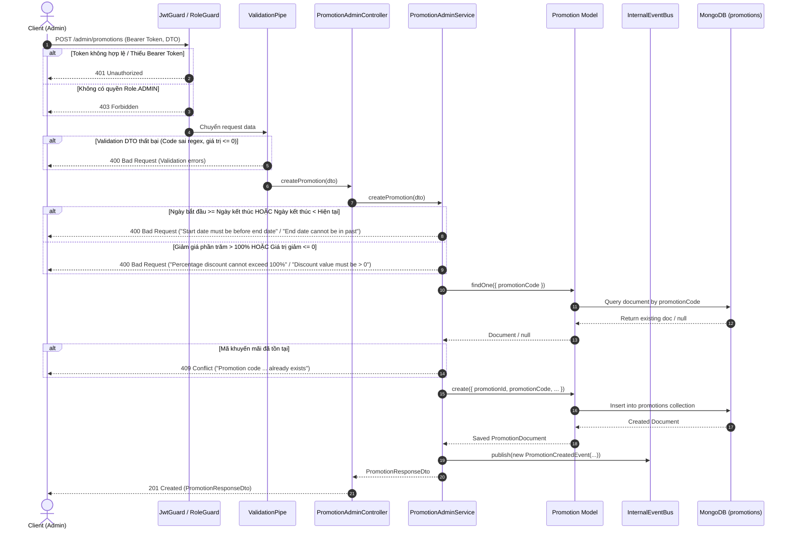
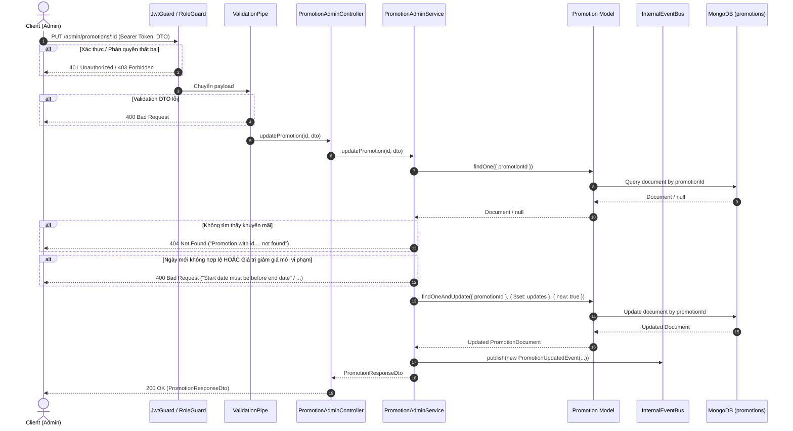
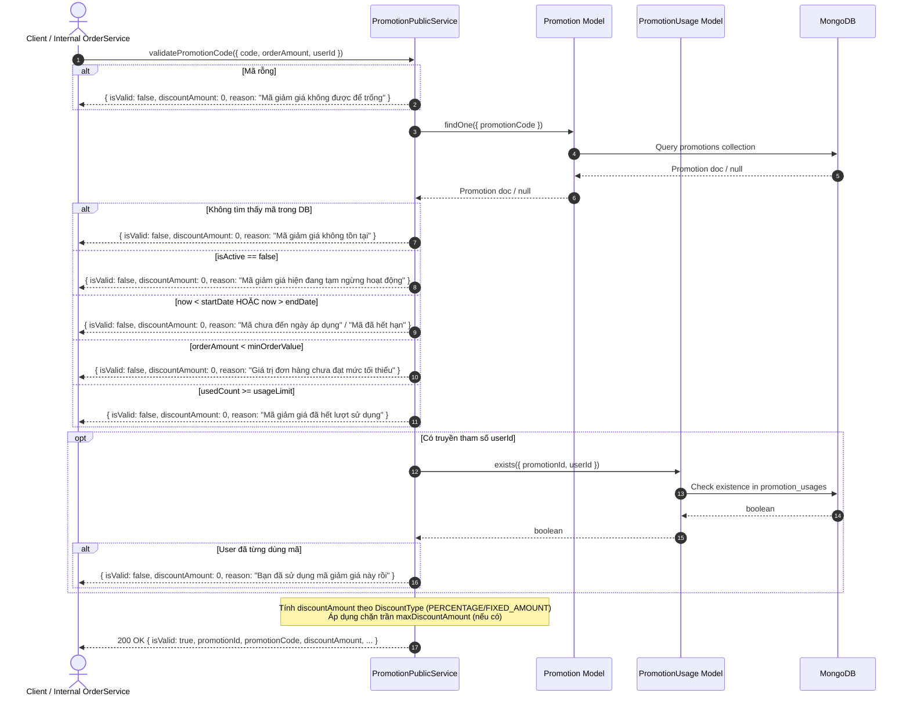
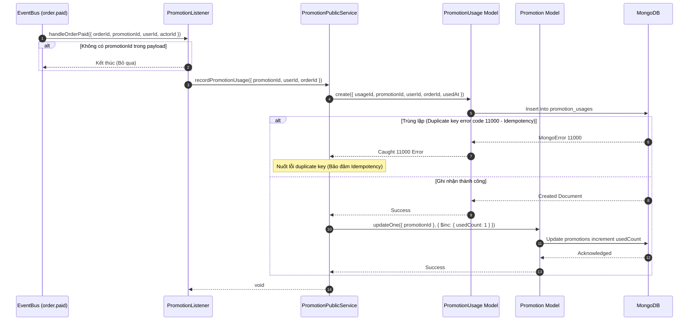

# Software Design Specification - Mục II: Code Designs (Promotion Module)

### THÔNG TIN MODULE:
- Tên tính năng / Tên Module: Promotion Module
- Thư mục Module: `backend/src/modules/promotion`
- Database: MongoDB
- ORM / Driver: Mongoose

---

### 1. Class Diagram

```mermaid
classDiagram
    class JwtGuard {
        +canActivate(context: ExecutionContext): boolean
    }

    class RoleGuard {
        +canActivate(context: ExecutionContext): boolean
    }

    class PromotionAdminController {
        -promotionAdminService: PromotionAdminService
        +createPromotion(dto: CreatePromotionDto): Promise~PromotionResponseDto~
        +getPromotions(query: QueryPromotionsDto): Promise~Page~PromotionResponseDto~~
        +getPromotionById(id: string): Promise~PromotionResponseDto~
        +updatePromotion(id: string, dto: UpdatePromotionDto): Promise~PromotionResponseDto~
        +changePromotionStatus(id: string, dto: ChangePromotionStatusDto): Promise~PromotionResponseDto~
    }

    class PromotionAdminService {
        -promotionModel: Model~PromotionDocument~
        -eventBus: InternalEventBus
        +createPromotion(dto: CreatePromotionDto): Promise~PromotionResponseDto~
        +getPromotions(query: QueryPromotionsDto): Promise~Page~PromotionResponseDto~~
        +getPromotionById(promotionId: string): Promise~PromotionResponseDto~
        +updatePromotion(promotionId: string, dto: UpdatePromotionDto): Promise~PromotionResponseDto~
        +changePromotionStatus(promotionId: string, isActive: boolean): Promise~PromotionResponseDto~
    }

    class PromotionPublicService {
        -promotionModel: Model~PromotionDocument~
        -promotionUsageModel: Model~PromotionUsageDocument~
        +validatePromotionCode(params: ValidatePromotionCodeParams): Promise~ValidatePromotionResult~
        +recordPromotionUsage(params: RecordPromotionUsageParams): Promise~void~
        +getPromotionById(promotionId: string): Promise~PromotionResponseDto | null~
    }

    class PromotionContractImpl {
        -promotionPublicService: PromotionPublicService
        +getPromotionById(promotionId: string): Promise~PromotionResponseDto | null~
        +validatePromotionCode(params: ValidatePromotionCodeParams): Promise~ValidatePromotionResult~
        +recordPromotionUsage(params: RecordPromotionUsageParams): Promise~void~
    }

    class PromotionListener {
        -promotionPublicService: PromotionPublicService
        -logger: Logger
        +handleOrderPaid(payload: OrderPaidPayload): Promise~void~
    }

    class CreatePromotionDto {
        +promotionCode: string
        +discountValue: number
        +discountType: DiscountType
        +startDate: string
        +endDate: string
        +isActive?: boolean
    }

    class UpdatePromotionDto {
        +discountValue?: number
        +discountType?: DiscountType
        +startDate?: string
        +endDate?: string
        +isActive?: boolean
    }

    class ChangePromotionStatusDto {
        +isActive: boolean
    }

    class QueryPromotionsDto {
        +page?: number
        +limit?: number
        +search?: string
        +discountType?: DiscountType
        +isActive?: boolean
        +sortBy?: string
        +sortOrder?: string
    }

    class PromotionResponseDto {
        +promotionId: string
        +promotionCode: string
        +discountValue: number
        +discountType: DiscountType
        +startDate: Date
        +endDate: Date
        +isActive: boolean
        +createdAt: Date
        +updatedAt: Date
        +static of(doc: PromotionDocument): PromotionResponseDto
    }

    class Promotion {
        +promotionId: string
        +promotionCode: string
        +discountValue: number
        +discountType: DiscountType
        +startDate: Date
        +endDate: Date
        +isActive: boolean
        +minOrderValue?: number
        +maxDiscountAmount?: number
        +usageLimit?: number
        +usedCount?: number
        +createdAt: Date
        +updatedAt: Date
    }

    class PromotionUsage {
        +usageId: string
        +promotionId: string
        +userId: string
        +orderId: string
        +usedAt: Date
        +createdAt: Date
        +updatedAt: Date
    }

    class DiscountType {
        <<enumeration>>
        PERCENTAGE
        FIXED_AMOUNT
    }

    PromotionAdminController ..> JwtGuard : @UseGuards
    PromotionAdminController ..> RoleGuard : @UseGuards
    PromotionAdminController ..> PromotionAdminService : injects
    PromotionAdminController ..> CreatePromotionDto : receives
    PromotionAdminController ..> UpdatePromotionDto : receives
    PromotionAdminController ..> ChangePromotionStatusDto : receives
    PromotionAdminController ..> QueryPromotionsDto : receives
    PromotionAdminController ..> PromotionResponseDto : returns

    PromotionAdminService ..> Promotion : injects Model
    PromotionAdminService ..> PromotionResponseDto : returns

    PromotionPublicService ..> Promotion : injects Model
    PromotionPublicService ..> PromotionUsage : injects Model

    PromotionContractImpl ..> PromotionPublicService : injects
    PromotionListener ..> PromotionPublicService : injects

    Promotion --> DiscountType : uses
    CreatePromotionDto --> DiscountType : uses
    UpdatePromotionDto --> DiscountType : uses
    PromotionResponseDto --> DiscountType : uses
```



---

### 2. Class Specifications

##### PromotionAdminController
**Class Methods:**
| No | Method | Description |
|---|---|---|
| 01 | `createPromotion(dto: CreatePromotionDto): Promise<PromotionResponseDto>` | - **Inputs:** `@Body()` `dto: CreatePromotionDto` (bắt buộc: `promotionCode` [chuỗi regex `^[A-Z0-9_-]+$`], `discountValue` [số thực > 0.01], `discountType` [enum `DiscountType`], `startDate` [chuỗi ISO DateString], `endDate` [chuỗi ISO DateString]; tùy chọn: `isActive` [boolean, mặc định true]).<br>- **Outputs:** `Promise<PromotionResponseDto>`, HTTP 201 Created.<br>- **Internal method processing:**<br>1. Request đi qua `JwtGuard` để xác thực JWT token (trả về 401 nếu thiếu/hỏng token).<br>2. Request đi qua `RoleGuard` kiểm tra quyền `@Roles(Role.ADMIN)` (trả về 403 nếu không phải ADMIN).<br>3. Request đi qua `ValidationPipe` whitelist & transform dữ liệu theo rules của `CreatePromotionDto` (trả về 400 nếu sai format).<br>4. Gọi `this.promotionAdminService.createPromotion(dto)`.<br>5. Trả về DTO khuyến mãi vừa tạo thành công hoặc ném exception nếu vi phạm business rules. |
| 02 | `getPromotions(query: QueryPromotionsDto): Promise<Page<PromotionResponseDto>>` | - **Inputs:** `@Query()` `query: QueryPromotionsDto` (kế thừa `PageRequest`: `page` [số nguyên >= 1], `limit` [số nguyên >= 1]; tùy chọn: `search` [chuỗi ký tự], `discountType` [enum `DiscountType`], `isActive` [boolean parse từ query string], `sortBy` [enum: `'createdAt'`, `'startDate'`, `'endDate'`, `'promotionCode'`, mặc định `'createdAt'`], `sortOrder` [enum: `'asc'`, `'desc'`, mặc định `'desc'`]).<br>- **Outputs:** `Promise<Page<PromotionResponseDto>>`, HTTP 200 OK.<br>- **Internal method processing:**<br>1. Xác thực `JwtGuard` (401) và `RoleGuard` (403).<br>2. `ValidationPipe` validate và transform kiểu dữ liệu các query params.<br>3. Gọi `this.promotionAdminService.getPromotions(query)`.<br>4. Trả về đối tượng phân trang `Page<PromotionResponseDto>` gồm mảng dữ liệu và metadata phân trang. |
| 03 | `getPromotionById(id: string): Promise<PromotionResponseDto>` | - **Inputs:** `@Param('id')` `id: string` (mã định danh duy nhất của khuyến mãi `promotionId`).<br>- **Outputs:** `Promise<PromotionResponseDto>`, HTTP 200 OK.<br>- **Internal method processing:**<br>1. Xác thực `JwtGuard` (401) và `RoleGuard` (403).<br>2. Gọi `this.promotionAdminService.getPromotionById(id)`.<br>3. Trả về chi tiết khuyến mãi dạng `PromotionResponseDto` nếu tìm thấy; ném `NotFoundException` (404) nếu không tồn tại. |
| 04 | `updatePromotion(id: string, dto: UpdatePromotionDto): Promise<PromotionResponseDto>` | - **Inputs:** `@Param('id')` `id: string`, `@Body()` `dto: UpdatePromotionDto` (tất cả trường tùy chọn: `discountValue` [số thực > 0.01], `discountType` [enum `DiscountType`], `startDate` [chuỗi ISO DateString], `endDate` [chuỗi ISO DateString], `isActive` [boolean]).<br>- **Outputs:** `Promise<PromotionResponseDto>`, HTTP 200 OK.<br>- **Internal method processing:**<br>1. Xác thực `JwtGuard` (401) và `RoleGuard` (403).<br>2. `ValidationPipe` kiểm tra dữ liệu payload cập nhật.<br>3. Gọi `this.promotionAdminService.updatePromotion(id, dto)`.<br>4. Trả về `PromotionResponseDto` đã cập nhật; ném `NotFoundException` (404) nếu không tìm thấy bản ghi, hoặc `BadRequestException` (400) nếu ngày/giá trị chiết khấu không hợp lệ. |
| 05 | `changePromotionStatus(id: string, dto: ChangePromotionStatusDto): Promise<PromotionResponseDto>` | - **Inputs:** `@Param('id')` `id: string`, `@Body()` `dto: ChangePromotionStatusDto` (bắt buộc: `isActive` [boolean]).<br>- **Outputs:** `Promise<PromotionResponseDto>`, HTTP 200 OK.<br>- **Internal method processing:**<br>1. Xác thực `JwtGuard` (401) và `RoleGuard` (403).<br>2. `ValidationPipe` xác nhận trường `isActive` là kiểu boolean hợp lệ.<br>3. Gọi `this.promotionAdminService.changePromotionStatus(id, dto.isActive)`.<br>4. Trả về `PromotionResponseDto` với trạng thái mới; ném `NotFoundException` (404) nếu không tìm thấy khuyến mãi theo `id`. |

##### PromotionAdminService
**Class Methods:**
| No | Method | Description |
|---|---|---|
| 01 | `createPromotion(dto: CreatePromotionDto): Promise<PromotionResponseDto>` | - **Inputs:** `dto: CreatePromotionDto`.<br>- **Outputs:** `Promise<PromotionResponseDto>`.<br>- **Internal method processing:**<br>1. Chuẩn hóa mã khuyến mãi: `code = dto.promotionCode.trim().toUpperCase()`.<br>2. Ép kiểu và kiểm tra ngày: `startDate = new Date(dto.startDate)`, `endDate = new Date(dto.endDate)`. Nếu `startDate >= endDate` ném `BadRequestException('Start date must be before end date')`.<br>3. Kiểm tra hạn kết thúc: Nếu `endDate < now` ném `BadRequestException('End date cannot be in the past')`.<br>4. Kiểm tra giá trị giảm giá: Nếu `dto.discountValue <= 0` ném `BadRequestException('Discount value must be greater than 0')`.<br>5. Nếu `dto.discountType === DiscountType.PERCENTAGE` và `dto.discountValue > 100` ném `BadRequestException('Percentage discount cannot exceed 100%')`.<br>6. Truy vấn MongoDB kiểm tra trùng lặp: `promotionModel.findOne({ promotionCode: code })`. Nếu đã tồn tại, ném `ConflictException('Promotion code ... already exists')`.<br>7. Ghi bản ghi mới vào database bằng `promotionModel.create(...)`.<br>8. Phát sự kiện domain qua `eventBus.publish(new PromotionCreatedEvent(...))`.<br>9. Chuyển đổi Document thành `PromotionResponseDto.of(created)` và trả về. |
| 02 | `getPromotions(query: QueryPromotionsDto): Promise<Page<PromotionResponseDto>>` | - **Inputs:** `query: QueryPromotionsDto`.<br>- **Outputs:** `Promise<Page<PromotionResponseDto>>`.<br>- **Internal method processing:**<br>1. Trích xuất tham số phân trang: `page = query.page || 1`, `limit = query.limit || 10`, `skip = (page - 1) * limit`.<br>2. Khởi tạo đối tượng `filter: Record<string, any> = {}`.<br>3. Nếu có `query.search`: escape ký tự đặc biệt Regex và gán `filter.promotionCode = { $regex: escapedSearch, $options: 'i' }`.<br>4. Nếu có `query.discountType`: gán `filter.discountType = query.discountType`.<br>5. Nếu `query.isActive !== undefined`: gán `filter.isActive = query.isActive`.<br>6. Cấu hình sort theo `query.sortBy` (mặc định `'createdAt'`) và `query.sortOrder` (`'asc' ? 1 : -1`).<br>7. Chạy đồng thời `Promise.all`: `promotionModel.find(filter).sort(...).skip(skip).limit(limit)` và `promotionModel.countDocuments(filter)`.<br>8. Map các documents thành `PromotionResponseDto.of(doc)` và đóng gói vào `Page.from(items, total, page, limit)`. |
| 03 | `getPromotionById(promotionId: string): Promise<PromotionResponseDto>` | - **Inputs:** `promotionId: string`.<br>- **Outputs:** `Promise<PromotionResponseDto>`.<br>- **Internal method processing:**<br>1. Truy vấn MongoDB: `promotionModel.findOne({ promotionId })`.<br>2. Nếu kết quả null, ném `NotFoundException('Promotion with id ... not found')`.<br>3. Trả về `PromotionResponseDto.of(promotion)`. |
| 04 | `updatePromotion(promotionId: string, dto: UpdatePromotionDto): Promise<PromotionResponseDto>` | - **Inputs:** `promotionId: string`, `dto: UpdatePromotionDto`.<br>- **Outputs:** `Promise<PromotionResponseDto>`.<br>- **Internal method processing:**<br>1. Truy vấn lấy bản ghi hiện tại: `promotionModel.findOne({ promotionId })`. Nếu không tìm thấy, ném `NotFoundException('Promotion with id ... not found')`.<br>2. Tính toán ngày bắt đầu và kết thúc mới (`newStart = dto.startDate ? new Date(dto.startDate) : existing.startDate`, `newEnd = dto.endDate ? new Date(dto.endDate) : existing.endDate`). Nếu `newStart >= newEnd`, ném `BadRequestException('Start date must be before end date')`.<br>3. Tính toán giá trị chiết khấu mới: nếu `dto.discountValue !== undefined && dto.discountValue <= 0`, ném `BadRequestException('Discount value must be greater than 0')`.<br>4. Kiểm tra tỷ lệ phần trăm: nếu `effectiveType === DiscountType.PERCENTAGE` và `effectiveValue > 100`, ném `BadRequestException('Percentage discount cannot exceed 100%')`.<br>5. Thực hiện cập nhật: `promotionModel.findOneAndUpdate({ promotionId }, { $set: updates }, { new: true })`. Nếu null ném `NotFoundException`.<br>6. Phát sự kiện domain `eventBus.publish(new PromotionUpdatedEvent(...))`.<br>7. Trả về `PromotionResponseDto.of(updated)`. |
| 05 | `changePromotionStatus(promotionId: string, isActive: boolean): Promise<PromotionResponseDto>` | - **Inputs:** `promotionId: string`, `isActive: boolean`.<br>- **Outputs:** `Promise<PromotionResponseDto>`.<br>- **Internal method processing:**<br>1. Thực thi cập nhật trực tiếp: `promotionModel.findOneAndUpdate({ promotionId }, { $set: { isActive } }, { new: true })`.<br>2. Nếu không tìm thấy bản ghi (trả về null), ném `NotFoundException('Promotion with id ... not found')`.<br>3. Phát sự kiện domain `eventBus.publish(new PromotionStatusChangedEvent(updated.promotionId, updated.promotionCode, isActive))`.<br>4. Trả về `PromotionResponseDto.of(updated)`. |

##### PromotionPublicService
**Class Methods:**
| No | Method | Description |
|---|---|---|
| 01 | `validatePromotionCode(params: { code: string; orderAmount: number; userId?: string }): Promise<ValidatePromotionResult>` | - **Inputs:** `params: { code: string; orderAmount: number; userId?: string }`.<br>- **Outputs:** `Promise<ValidatePromotionResult>` (`{ isValid: boolean; promotionId?: string; promotionCode?: string; discountType?: DiscountType; discountValue?: number; discountAmount: number; reason?: string }`).<br>- **Internal method processing:**<br>1. Chuẩn hóa mã: `normalizedCode = (params.code || '').trim().toUpperCase()`. Nếu rỗng, trả về `{ isValid: false, discountAmount: 0, reason: 'Mã giảm giá không được để trống' }`.<br>2. Truy vấn MongoDB: `promotionModel.findOne({ promotionCode: normalizedCode })`. Nếu không tìm thấy, trả về `{ isValid: false, discountAmount: 0, reason: 'Mã giảm giá không tồn tại' }`.<br>3. Kiểm tra kích hoạt: Nếu `!promotion.isActive`, trả về `{ isValid: false, discountAmount: 0, reason: 'Mã giảm giá hiện đang tạm ngừng hoạt động' }`.<br>4. Kiểm tra thời hạn: Lấy `now = new Date()`. Nếu `now < promotion.startDate`, trả về `{ isValid: false, discountAmount: 0, reason: 'Mã giảm giá chưa đến ngày áp dụng' }`. Nếu `now > promotion.endDate`, trả về `{ isValid: false, discountAmount: 0, reason: 'Mã giảm giá đã hết hạn sử dụng' }`.<br>5. Kiểm tra giá trị đơn tối thiểu: Nếu `promotion.minOrderValue > 0 && params.orderAmount < promotion.minOrderValue`, trả về `{ isValid: false, discountAmount: 0, reason: 'Giá trị đơn hàng chưa đạt mức tối thiểu...' }`.<br>6. Kiểm tra giới hạn lượt dùng hệ thống: Nếu `promotion.usageLimit > 0 && (promotion.usedCount || 0) >= promotion.usageLimit`, trả về `{ isValid: false, discountAmount: 0, reason: 'Mã giảm giá đã hết lượt sử dụng' }`.<br>7. Kiểm tra giới hạn theo user (nếu có `params.userId`): Truy vấn `promotionUsageModel.exists({ promotionId: promotion.promotionId, userId: params.userId })`. Nếu đã tồn tại, trả về `{ isValid: false, discountAmount: 0, reason: 'Bạn đã sử dụng mã giảm giá này rồi' }`.<br>8. Tính số tiền chiết khấu:<br>- Nếu `PERCENTAGE`: `discountAmount = Math.round((params.orderAmount * promotion.discountValue) / 100)`.<br>- Nếu `FIXED_AMOUNT`: `discountAmount = Math.min(promotion.discountValue, params.orderAmount)`.<br>9. Áp dụng giới hạn giảm tối đa: Nếu `PERCENTAGE` và `promotion.maxDiscountAmount > 0`, gán `discountAmount = Math.min(discountAmount, promotion.maxDiscountAmount)`.<br>10. Trả về kết quả thành công `{ isValid: true, promotionId: promotion.promotionId, promotionCode: promotion.promotionCode, discountType: promotion.discountType, discountValue: promotion.discountValue, discountAmount }`. |
| 02 | `recordPromotionUsage(params: { promotionId: string; userId: string; orderId: string }): Promise<void>` | - **Inputs:** `params: { promotionId: string; userId: string; orderId: string }`.<br>- **Outputs:** `Promise<void>`.<br>- **Internal method processing:**<br>1. Chuẩn bị bản ghi sử dụng: tạo mới `usageId = randomUUID()`, `usedAt = new Date()`.<br>2. Ghi bản ghi vào collection `promotion_usages` bằng `promotionUsageModel.create(...)`.<br>3. Tăng biến đếm số lượt đã dùng của mã trong collection `promotions`: `promotionModel.updateOne({ promotionId: params.promotionId }, { $inc: { usedCount: 1 } })`.<br>4. Bắt lỗi ngoại lệ (Idempotency Guard): Nếu `error.code === 11000` (vi phạm unique index `{ promotionId: 1, userId: 1 }`), bỏ qua lỗi (idempotent retry). Nếu lỗi khác, re-throw exception. |
| 03 | `getPromotionById(promotionId: string): Promise<PromotionResponseDto \| null>` | - **Inputs:** `promotionId: string`.<br>- **Outputs:** `Promise<PromotionResponseDto | null>`.<br>- **Internal method processing:**<br>1. Truy vấn MongoDB: `promotionModel.findOne({ promotionId })`.<br>2. Nếu không tìm thấy, trả về `null`.<br>3. Nếu tìm thấy, chuyển đổi sang `PromotionResponseDto.of(doc)` và trả về. |

##### PromotionListener
**Class Methods:**
| No | Method | Description |
|---|---|---|
| 01 | `handleOrderPaid(payload: { orderId: string; promotionId?: string; userId?: string; actorId?: string }): Promise<void>` | - **Inputs:** Event payload từ event `'order.paid'` (`orderId`, `promotionId`, `userId`, `actorId`).<br>- **Outputs:** `Promise<void>`.<br>- **Internal method processing:**<br>1. Kiểm tra payload: Nếu không có `payload.promotionId`, kết thúc xử lý (bỏ qua).<br>2. Xác định `targetUserId = payload.userId || payload.actorId || 'GUEST'`.<br>3. Gọi `this.promotionPublicService.recordPromotionUsage({ promotionId: payload.promotionId, userId: targetUserId, orderId: payload.orderId })`.<br>4. Đặt trong khối `try/catch`: Ghi log nếu xảy ra ngoại lệ để không làm gián đoạn tiến trình background event bus. |

---

### 3. Sequence Diagram(s)

#### Luồng 1: Tạo mới chương trình khuyến mãi (POST /admin/promotions)


#### Luồng 2: Cập nhật thông tin khuyến mãi (PUT /admin/promotions/:id)


#### Luồng 3: Kiểm tra và áp dụng mã khuyến mãi (Kiểm tra hợp lệ & tính chiết khấu)


#### Luồng 4: Ghi nhận sử dụng khuyến mãi qua Event thanh toán đơn hàng (order.paid)


---

### 4. Database Queries

#### 4.1. Tạo mới khuyến mãi (`createPromotion`)
- **Mongoose Shell Query:**
```javascript
db.promotions.insertOne({
  promotionId: "f47ac10b-58cc-4372-a567-0e02b2c3d479",
  promotionCode: "SUMMER2026",
  discountValue: 15,
  discountType: "PERCENTAGE",
  startDate: ISODate("2026-06-01T00:00:00.000Z"),
  endDate: ISODate("2026-06-30T23:59:59.000Z"),
  isActive: true,
  usedCount: 0,
  createdAt: ISODate("2026-05-01T10:00:00.000Z"),
  updatedAt: ISODate("2026-05-01T10:00:00.000Z")
});
```
- **Raw SQL chuẩn tương đương:**
```sql
INSERT INTO promotions (
  promotion_id, promotion_code, discount_value, discount_type,
  start_date, end_date, is_active, used_count, created_at, updated_at
) VALUES (
  'f47ac10b-58cc-4372-a567-0e02b2c3d479', 'SUMMER2026', 15, 'PERCENTAGE',
  '2026-06-01 00:00:00', '2026-06-30 23:59:59', TRUE, 0, NOW(), NOW()
);
```

#### 4.2. Kiểm tra trùng mã khuyến mãi (`createPromotion`)
- **Mongoose Shell Query:**
```javascript
db.promotions.findOne({ promotionCode: "SUMMER2026" });
```
- **Raw SQL chuẩn tương đương:**
```sql
SELECT * FROM promotions 
WHERE promotion_code = 'SUMMER2026' 
LIMIT 1;
```

#### 4.3. Lấy danh sách khuyến mãi có tìm kiếm, lọc và phân trang (`getPromotions`)
- **Mongoose Shell Query:**
```javascript
// 1. Lấy dữ liệu phân trang
db.promotions.find({
  promotionCode: { $regex: "SUMMER", $options: "i" },
  discountType: "PERCENTAGE",
  isActive: true
})
.sort({ createdAt: -1 })
.skip(0)
.limit(10);

// 2. Đếm tổng số bản ghi khớp điều kiện lọc
db.promotions.countDocuments({
  promotionCode: { $regex: "SUMMER", $options: "i" },
  discountType: "PERCENTAGE",
  isActive: true
});
```
- **Raw SQL chuẩn tương đương:**
```sql
-- 1. Truy vấn danh sách
SELECT * FROM promotions
WHERE promotion_code ILIKE '%SUMMER%'
  AND discount_type = 'PERCENTAGE'
  AND is_active = TRUE
ORDER BY created_at DESC
LIMIT 10 OFFSET 0;

-- 2. Truy vấn đếm tổng số
SELECT COUNT(*) AS total FROM promotions
WHERE promotion_code ILIKE '%SUMMER%'
  AND discount_type = 'PERCENTAGE'
  AND is_active = TRUE;
```

#### 4.4. Lấy chi tiết khuyến mãi theo ID (`getPromotionById`)
- **Mongoose Shell Query:**
```javascript
db.promotions.findOne({ promotionId: "f47ac10b-58cc-4372-a567-0e02b2c3d479" });
```
- **Raw SQL chuẩn tương đương:**
```sql
SELECT * FROM promotions 
WHERE promotion_id = 'f47ac10b-58cc-4372-a567-0e02b2c3d479' 
LIMIT 1;
```

#### 4.5. Cập nhật thông tin khuyến mãi (`updatePromotion`)
- **Mongoose Shell Query:**
```javascript
db.promotions.findOneAndUpdate(
  { promotionId: "f47ac10b-58cc-4372-a567-0e02b2c3d479" },
  {
    $set: {
      discountValue: 20,
      endDate: ISODate("2026-07-15T23:59:59.000Z"),
      updatedAt: ISODate("2026-05-02T10:00:00.000Z")
    }
  },
  { returnDocument: "after" }
);
```
- **Raw SQL chuẩn tương đương:**
```sql
UPDATE promotions
SET discount_value = 20,
    end_date = '2026-07-15 23:59:59',
    updated_at = NOW()
WHERE promotion_id = 'f47ac10b-58cc-4372-a567-0e02b2c3d479'
RETURNING *;
```

#### 4.6. Bật / Tắt trạng thái kích hoạt khuyến mãi (`changePromotionStatus`)
- **Mongoose Shell Query:**
```javascript
db.promotions.findOneAndUpdate(
  { promotionId: "f47ac10b-58cc-4372-a567-0e02b2c3d479" },
  {
    $set: {
      isActive: false,
      updatedAt: ISODate("2026-05-02T11:00:00.000Z")
    }
  },
  { returnDocument: "after" }
);
```
- **Raw SQL chuẩn tương đương:**
```sql
UPDATE promotions
SET is_active = FALSE,
    updated_at = NOW()
WHERE promotion_id = 'f47ac10b-58cc-4372-a567-0e02b2c3d479'
RETURNING *;
```

#### 4.7. Kiểm tra người dùng đã từng sử dụng khuyến mãi (`validatePromotionCode`)
- **Mongoose Shell Query:**
```javascript
db.promotion_usages.findOne(
  { promotionId: "f47ac10b-58cc-4372-a567-0e02b2c3d479", userId: "usr_01HXYZ12345" },
  { _id: 1 }
);
```
- **Raw SQL chuẩn tương đương:**
```sql
SELECT EXISTS (
  SELECT 1 FROM promotion_usages
  WHERE promotion_id = 'f47ac10b-58cc-4372-a567-0e02b2c3d479'
    AND user_id = 'usr_01HXYZ12345'
) AS is_exists;
```

#### 4.8. Ghi nhận lịch sử áp dụng khuyến mãi (`recordPromotionUsage`)
- **Mongoose Shell Query:**
```javascript
// 1. Lưu bản ghi sử dụng
db.promotion_usages.insertOne({
  usageId: "a1b2c3d4-e5f6-7890-abcd-ef1234567890",
  promotionId: "f47ac10b-58cc-4372-a567-0e02b2c3d479",
  userId: "usr_01HXYZ12345",
  orderId: "ord_9988776655",
  usedAt: ISODate("2026-05-02T12:00:00.000Z"),
  createdAt: ISODate("2026-05-02T12:00:00.000Z"),
  updatedAt: ISODate("2026-05-02T12:00:00.000Z")
});

// 2. Tăng số lượt sử dụng
db.promotions.updateOne(
  { promotionId: "f47ac10b-58cc-4372-a567-0e02b2c3d479" },
  { $inc: { usedCount: 1 } }
);
```
- **Raw SQL chuẩn tương đương:**
```sql
-- 1. Lưu bản ghi sử dụng
INSERT INTO promotion_usages (
  usage_id, promotion_id, user_id, order_id, used_at, created_at, updated_at
) VALUES (
  'a1b2c3d4-e5f6-7890-abcd-ef1234567890', 'f47ac10b-58cc-4372-a567-0e02b2c3d479',
  'usr_01HXYZ12345', 'ord_9988776655', NOW(), NOW(), NOW()
);

-- 2. Tăng số lượt sử dụng
UPDATE promotions
SET used_count = COALESCE(used_count, 0) + 1
WHERE promotion_id = 'f47ac10b-58cc-4372-a567-0e02b2c3d479';
```
