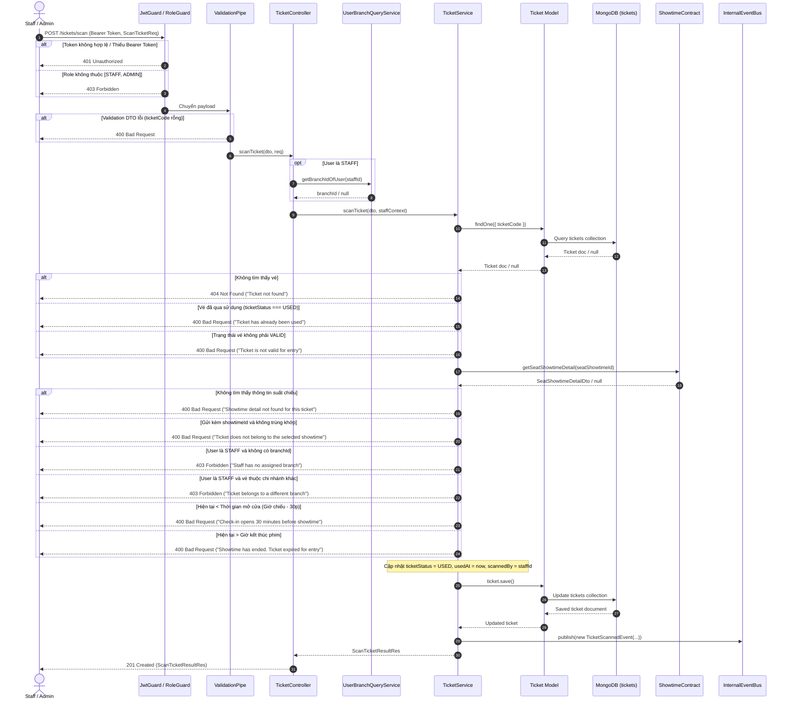
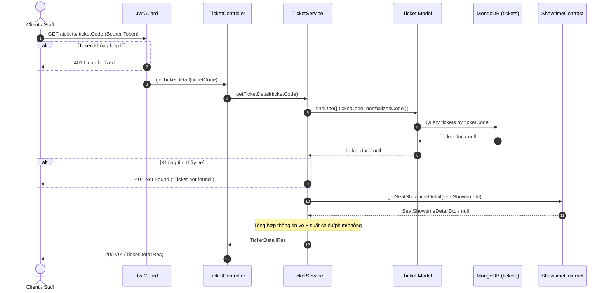
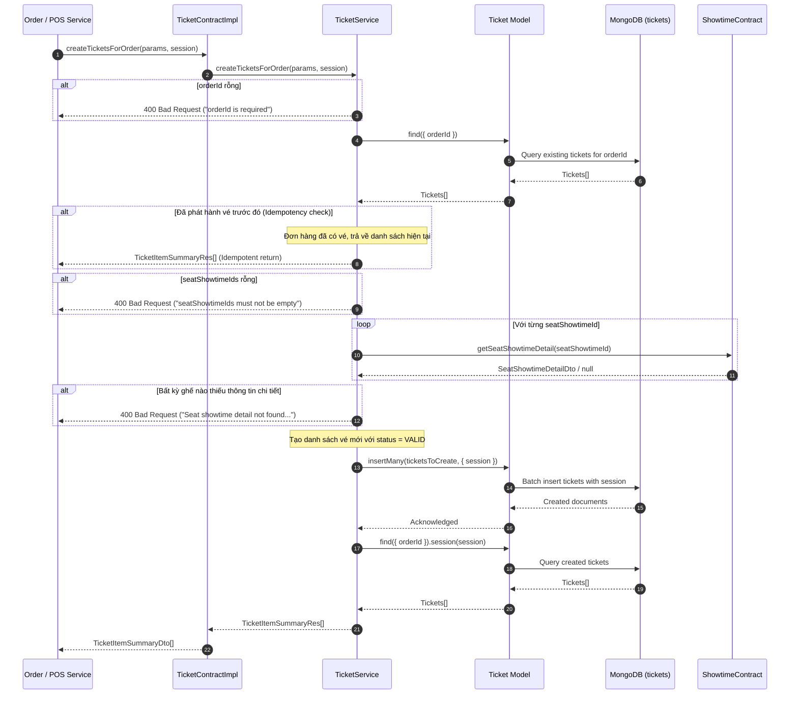

# Software Design Specification — Mục II: Code Designs (Ticket Module)

- **Tên module:** Ticket
- **Thư mục:** `backend/src/modules/ticket`
- **Database:** MongoDB
- **Driver:** Mongoose

---

### 1. Class Diagram

```mermaid
classDiagram
    class JwtGuard {
        +canActivate(context: ExecutionContext): boolean
    }

    class RoleGuard {
        +canActivate(context: ExecutionContext): boolean
    }

    class TicketController {
        -ticketService: TicketService
        -userBranchQueryService: UserBranchQueryService
        +scanTicket(dto: ScanTicketReq, req: Request): Promise~ScanTicketResultRes~
        +getTicketDetail(ticketCode: string): Promise~TicketDetailRes~
    }

    class TicketService {
        -ticketModel: Model~TicketDocument~
        -showtimeContract: ShowtimeContract
        -eventBus: InternalEventBus
        +scanTicket(dto: ScanTicketReq, staffContext: StaffScanContextReq): Promise~ScanTicketResultRes~
        +getTicketDetail(ticketCode: string): Promise~TicketDetailRes~
        +getTicketsByOrderId(orderId: string, session?: ClientSession): Promise~TicketItemSummaryRes[]~
        +createTicketsForOrder(params: CreateTicketsForOrderParams, session?: ClientSession): Promise~TicketItemSummaryRes[]~
    }

    class TicketContract {
        <<interface>>
        +getTicketsByOrderId(orderId: string): Promise~TicketItemSummaryDto[]~
        +createTicketsForOrder(params: CreateTicketsForOrderParams, session?: ClientSession): Promise~TicketItemSummaryDto[]~
    }

    class TicketContractImpl {
        -ticketService: TicketService
        +getTicketsByOrderId(orderId: string): Promise~TicketItemSummaryDto[]~
        +createTicketsForOrder(params: CreateTicketsForOrderParams, session?: ClientSession): Promise~TicketItemSummaryDto[]~
    }

    class ScanTicketUsecase {
        <<interface>>
        +scanTicket(dto: ScanTicketReq, staffContext: StaffScanContextReq): Promise~ScanTicketResultRes~
    }

    class GetTicketDetailUsecase {
        <<interface>>
        +getTicketDetail(ticketCode: string): Promise~TicketDetailRes~
    }

    class CreateTicketsForOrderUsecase {
        <<interface>>
        +createTicketsForOrder(params: CreateTicketsForOrderParams, session?: ClientSession): Promise~TicketItemSummaryRes[]~
    }

    class ShowtimeContract {
        <<external contract>>
        +getSeatShowtimeDetail(seatShowtimeId: string): Promise~SeatShowtimeDetailDto~
    }

    class InternalEventBus {
        <<external interface>>
        +publish(event: DomainEvent): Promise~void~
    }

    class TicketScannedEvent {
        +ticketId: string
        +ticketCode: string
        +scannedBy: string
        +scannedAt: Date
        +getEventName(): string
    }

    class ScanTicketReq {
        +ticketCode: string
        +showtimeId?: string
    }

    class StaffScanContextReq {
        +staffId: string
        +branchId?: string
        +role?: string
    }

    class TicketDetailRes {
        +ticketId: string
        +ticketCode: string
        +orderId: string
        +seatShowtimeId: string
        +price: number
        +ticketStatus: TicketStatus
        +usedAt?: Date
        +scannedBy?: string
        +movieTitle: string
        +roomName: string
        +seatName: string
        +branchName: string
        +startTime: Date
        +endTime: Date
    }

    class ScanTicketResultRes {
        +ticketId: string
        +ticketCode: string
        +seatName: string
        +movieTitle: string
        +roomName: string
        +branchName: string
        +startTime: Date
        +endTime: Date
        +ticketStatus: TicketStatus
        +scannedBy: string
        +scannedAt: Date
        +message: string
    }

    class TicketItemSummaryRes {
        +ticketId: string
        +ticketCode: string
        +seatShowtimeId: string
        +price: number
        +ticketStatus: TicketStatus
        +seatName: string
        +movieTitle: string
        +roomName: string
        +startTime: Date
    }

    class Ticket {
        +ticketId: string
        +orderId: string
        +seatShowtimeId: string
        +ticketCode: string
        +price: number
        +ticketStatus: TicketStatus
        +usedAt?: Date
        +scannedBy?: string
        +createdAt: Date
        +updatedAt: Date
    }

    class TicketStatus {
        <<enumeration>>
        VALID
        USED
        CANCELLED
        EXPIRED
    }

    TicketController ..> JwtGuard : @UseGuards
    TicketController ..> RoleGuard : @UseGuards
    TicketController ..> TicketService : injects
    TicketController ..> ScanTicketReq : receives
    TicketController ..> ScanTicketResultRes : returns
    TicketController ..> TicketDetailRes : returns

    TicketService ..|> ScanTicketUsecase : implements
    TicketService ..|> GetTicketDetailUsecase : implements
    TicketService ..|> CreateTicketsForOrderUsecase : implements
    TicketService ..> Ticket : injects Model
    TicketService ..> ShowtimeContract : injects
    TicketService ..> InternalEventBus : injects
    TicketService ..> TicketScannedEvent : creates & publishes

    TicketContractImpl ..|> TicketContract : implements
    TicketContractImpl ..> TicketService : injects

    Ticket --> TicketStatus : uses
    TicketDetailRes --> TicketStatus : uses
    ScanTicketResultRes --> TicketStatus : uses
    TicketItemSummaryRes --> TicketStatus : uses
```



---

### 2. Class Specifications

##### TicketController
**Class Methods:**
| No | Method | Description |
|---|---|---|
| 01 | `scanTicket(dto: ScanTicketReq, req: Request): Promise<ScanTicketResultRes>` | - **Inputs:**<br>&nbsp;&nbsp;+ `@Body()` `dto: ScanTicketReq` (bắt buộc: `ticketCode` [string, trimmed, `@IsNotEmpty`]; tùy chọn: `showtimeId` [string, trimmed]).<br>&nbsp;&nbsp;+ `@Req()` `req: Request` (chứa user trích xuất từ JWT token: `userId`, `sub`, `role`).<br>- **Outputs:** `Promise<ScanTicketResultRes>`, HTTP 201 Created.<br>- **Internal method processing:**<br>1. Request đi qua `JwtGuard` xác thực Bearer token (401 Unauthorized nếu thiếu/sai token).<br>2. Request đi qua `RoleGuard` kiểm tra `@Roles(Role.STAFF, Role.ADMIN)` (403 Forbidden nếu không đủ quyền).<br>3. `ValidationPipe` whitelist & transform payload đầu vào theo `ScanTicketReq`.<br>4. Trích xuất thông tin người quét: `staffId = req.user?.userId || req.user?.sub || 'staff-default'`, `role = req.user?.role || Role.STAFF`.<br>5. Nếu `role === Role.STAFF`, gọi `this.userBranchQueryService.getBranchIdOfUser(staffId)` để lấy `branchId` của nhân viên; nếu là ADMIN thì không cần gán `branchId`.<br>6. Khởi tạo `staffContext: StaffScanContextReq` gồm `{ staffId, branchId, role }`.<br>7. Gọi `this.ticketService.scanTicket(dto, staffContext)`.<br>8. Trả về kết quả soát vé dạng `ScanTicketResultRes` hoặc ném exception nếu vi phạm business rules. |
| 02 | `getTicketDetail(ticketCode: string): Promise<TicketDetailRes>` | - **Inputs:** `@Param('ticketCode')` `ticketCode: string` (mã vé in trên vé / QR code).<br>- **Outputs:** `Promise<TicketDetailRes>`, HTTP 200 OK.<br>- **Internal method processing:**<br>1. Request đi qua `JwtGuard` xác thực token người dùng (401 Unauthorized).<br>2. Gọi `this.ticketService.getTicketDetail(ticketCode)`.<br>3. Trả về chi tiết vé cùng thông tin suất chiếu/phim/phòng dạng `TicketDetailRes`; ném `NotFoundException` (404) nếu không tìm thấy mã vé trong hệ thống. |

##### TicketService
**Class Methods:**
| No | Method | Description |
|---|---|---|
| 01 | `scanTicket(dto: ScanTicketReq, staffContext: StaffScanContextReq): Promise<ScanTicketResultRes>` | - **Inputs:** `dto: ScanTicketReq`, `staffContext: StaffScanContextReq`.<br>- **Outputs:** `Promise<ScanTicketResultRes>`.<br>- **Internal method processing:**<br>1. Chuẩn hóa `ticketCode`: `normalizedCode = (dto.ticketCode || '').trim()`. Nếu rỗng, ném `BadRequestException('Ticket code is required')`.<br>2. Truy vấn MongoDB: `this.ticketModel.findOne({ ticketCode: normalizedCode }).exec()`.<br>3. Nếu vé không tồn tại, ném `NotFoundException('Ticket not found')`.<br>4. Kiểm tra trạng thái vé:<br>&nbsp;&nbsp;+ Nếu `ticket.ticketStatus === TicketStatus.USED`, ném `BadRequestException('Ticket has already been used')`.<br>&nbsp;&nbsp;+ Nếu `ticket.ticketStatus !== TicketStatus.VALID`, ném `BadRequestException('Ticket is not valid for entry')`.<br>5. Gọi contract ngoại bộ `this.showtimeContract.getSeatShowtimeDetail(ticket.seatShowtimeId)` để lấy thông tin suất chiếu, phòng chiếu, chi nhánh và phim.<br>6. Nếu không tìm thấy thông tin suất chiếu từ contract, ném `BadRequestException('Showtime detail not found for this ticket')`.<br>7. Nếu người dùng gửi kèm `dto.showtimeId` và `showtimeDetail.showtimeId !== dto.showtimeId.trim()`, ném `BadRequestException('Ticket does not belong to the selected showtime')`.<br>8. Kiểm tra phân quyền chi nhánh: Nếu `staffContext.role === Role.STAFF`:<br>&nbsp;&nbsp;+ Nếu `!staffContext.branchId`, ném `ForbiddenException('Staff has no assigned branch')`.<br>&nbsp;&nbsp;+ Nếu `showtimeDetail.branchId !== staffContext.branchId`, ném `ForbiddenException('Ticket belongs to a different branch')`.<br>9. Kiểm tra khung giờ soát vé: Lấy `now = new Date()`, `checkInWindowStart = new Date(showtimeDetail.startTime.getTime() - 30 * 60 * 1000)` (30 phút trước giờ chiếu), `checkInWindowEnd = showtimeDetail.endTime`.<br>&nbsp;&nbsp;+ Nếu `now < checkInWindowStart`, ném `BadRequestException('Check-in opens 30 minutes before showtime')`.<br>&nbsp;&nbsp;+ Nếu `now > checkInWindowEnd`, ném `BadRequestException('Showtime has ended. Ticket expired for entry')`.<br>10. Cập nhật trạng thái vé: `ticket.ticketStatus = TicketStatus.USED`, `ticket.usedAt = now`, `ticket.scannedBy = staffContext.staffId`.<br>11. Lưu vào database: `await ticket.save()`.<br>12. Phát sự kiện domain: `this.eventBus.publish(new TicketScannedEvent(ticket.ticketId, ticket.ticketCode, staffContext.staffId, now))`.<br>13. Trả về `ScanTicketResultRes` hoàn chỉnh kèm lời nhắn thành công. |
| 02 | `getTicketDetail(ticketCode: string): Promise<TicketDetailRes>` | - **Inputs:** `ticketCode: string`.<br>- **Outputs:** `Promise<TicketDetailRes>`.<br>- **Internal method processing:**<br>1. Chuẩn hóa `ticketCode`: `normalizedCode = (ticketCode || '').trim()`.<br>2. Truy vấn MongoDB: `this.ticketModel.findOne({ ticketCode: normalizedCode }).exec()`.<br>3. Nếu vé không tồn tại, ném `NotFoundException('Ticket not found')`.<br>4. Gọi `this.showtimeContract.getSeatShowtimeDetail(ticket.seatShowtimeId)` để trích xuất dữ liệu suất chiếu.<br>5. Đóng gói và trả về `TicketDetailRes` (sử dụng fallback giá trị mặc định nếu contract không trả đủ trường dữ liệu). |
| 03 | `getTicketsByOrderId(orderId: string, session?: ClientSession): Promise<TicketItemSummaryRes[]>` | - **Inputs:** `orderId: string`, tùy chọn `session?: ClientSession`.<br>- **Outputs:** `Promise<TicketItemSummaryRes[]>`.<br>- **Internal method processing:**<br>1. Xây dựng truy vấn: `query = this.ticketModel.find({ orderId: orderId.trim() })`. Nếu có `session`, gắn `query.session(session)`.<br>2. Thực thi truy vấn: `tickets = await query.exec()`.<br>3. Nếu mảng vé rỗng, trả về `[]`.<br>4. Với mỗi vé, gọi `this.showtimeContract.getSeatShowtimeDetail(ticket.seatShowtimeId)` song song hoặc tuần tự.<br>5. Map kết quả thành mảng `TicketItemSummaryRes` và trả về. |
| 04 | `createTicketsForOrder(params: CreateTicketsForOrderParams, session?: ClientSession): Promise<TicketItemSummaryRes[]>` | - **Inputs:** `params: { orderId: string; seatShowtimeIds: string[]; pricePerSeat?: number }`, tùy chọn `session?: ClientSession`.<br>- **Outputs:** `Promise<TicketItemSummaryRes[]>`.<br>- **Internal method processing:**<br>1. Kiểm tra tham số: Nếu `!params.orderId`, ném `BadRequestException('orderId is required')`.<br>2. Kiểm tra Idempotency: Gọi `this.getTicketsByOrderId(params.orderId)`. Nếu đã tồn tại vé cho đơn hàng này, trả về ngay danh sách vé hiện có mà không tạo thêm.<br>3. Kiểm tra danh sách ghế: Nếu `!params.seatShowtimeIds?.length`, ném `BadRequestException('seatShowtimeIds must not be empty')`.<br>4. Với từng `seatShowtimeId`, gọi `this.showtimeContract.getSeatShowtimeDetail(id)` để xác thực ghế và lấy giá.<br>5. Nếu thiếu thông tin chi tiết của bất kỳ ghế nào, ném `BadRequestException('Seat showtime detail not found for seat...')`.<br>6. Khởi tạo mảng documents vé cần tạo: sinh `ticketId = randomUUID()`, `ticketCode = sinh mã vé duy nhất`, `orderId`, `seatShowtimeId`, `price`, `ticketStatus = TicketStatus.VALID`.<br>7. Ghi nhận batch xuống DB: `await this.ticketModel.insertMany(ticketsToCreate, { session })`.<br>8. Gọi `this.getTicketsByOrderId(params.orderId, session)` để đọc lại danh sách vé đầy đủ và trả về. |

##### TicketContractImpl
**Class Methods:**
| No | Method | Description |
|---|---|---|
| 01 | `getTicketsByOrderId(orderId: string): Promise<TicketItemSummaryDto[]>` | Ủy thác gọi trực tiếp `this.ticketService.getTicketsByOrderId(orderId)`. |
| 02 | `createTicketsForOrder(params: CreateTicketsForOrderParams, session?: ClientSession): Promise<TicketItemSummaryDto[]>` | Ủy thác gọi trực tiếp `this.ticketService.createTicketsForOrder(params, session)`, truyền tiếp `ClientSession` để bảo đảm tính toàn vẹn transaction của đơn hàng. |

---

### 3. Sequence Diagram(s)

#### Luồng 1: Soát vé tại quầy / Cửa kiểm soát (POST /tickets/scan)


#### Luồng 2: Tra cứu chi tiết vé (GET /tickets/:ticketCode)


#### Luồng 3: Phát hành vé khi thanh toán đơn hàng (createTicketsForOrder)


---

### 4. Database Queries

*(Hệ thống sử dụng MongoDB qua driver Mongoose, dưới đây là truy vấn dịch sang Mongoose Shell Query và Raw SQL chuẩn tương đương)*

#### 4.1. Tìm kiếm vé theo mã vé (`scanTicket`, `getTicketDetail`)
- **Mongoose Shell Query:**
```javascript
db.tickets.findOne({ ticketCode: "TCK-A1-20261029-ABCD1234" });
```
- **Raw SQL chuẩn tương đương:**
```sql
SELECT * FROM tickets 
WHERE ticket_code = 'TCK-A1-20261029-ABCD1234' 
LIMIT 1;
```

#### 4.2. Cập nhật trạng thái vé sau khi quét thành công (`scanTicket`)
- **Mongoose Shell Query:**
```javascript
db.tickets.updateOne(
  { ticketCode: "TCK-A1-20261029-ABCD1234" },
  {
    $set: {
      ticketStatus: "USED",
      usedAt: ISODate("2026-10-29T10:15:30.000Z"),
      scannedBy: "staff_usr_01HXYZ12345",
      updatedAt: ISODate("2026-10-29T10:15:30.000Z")
    }
  }
);
```
- **Raw SQL chuẩn tương đương:**
```sql
UPDATE tickets 
SET ticket_status = 'USED',
    used_at = '2026-10-29 10:15:30',
    scanned_by = 'staff_usr_01HXYZ12345',
    updated_at = NOW()
WHERE ticket_code = 'TCK-A1-20261029-ABCD1234';
```

#### 4.3. Lấy danh sách vé theo mã đơn hàng (`getTicketsByOrderId`)
- **Mongoose Shell Query:**
```javascript
db.tickets.find({ orderId: "ord_998877665544" });
```
- **Raw SQL chuẩn tương đương:**
```sql
SELECT * FROM tickets 
WHERE order_id = 'ord_998877665544'
ORDER BY created_at ASC;
```

#### 4.4. Phát hành danh sách vé cho đơn hàng (`createTicketsForOrder`)
- **Mongoose Shell Query:**
```javascript
db.tickets.insertMany([
  {
    ticketId: "b8c3d9a1-52e4-411a-8c90-ef1234567890",
    orderId: "ord_998877665544",
    seatShowtimeId: "seat_st_001",
    ticketCode: "TCK-F8-20261029-A1B2C3D4",
    price: 85000,
    ticketStatus: "VALID",
    createdAt: ISODate("2026-10-29T09:00:00.000Z"),
    updatedAt: ISODate("2026-10-29T09:00:00.000Z")
  },
  {
    ticketId: "c9d4e0b2-63f5-522b-9d01-fa2345678901",
    orderId: "ord_998877665544",
    seatShowtimeId: "seat_st_002",
    ticketCode: "TCK-F9-20261029-E5F6G7H8",
    price: 85000,
    ticketStatus: "VALID",
    createdAt: ISODate("2026-10-29T09:00:00.000Z"),
    updatedAt: ISODate("2026-10-29T09:00:00.000Z")
  }
]);
```
- **Raw SQL chuẩn tương đương:**
```sql
INSERT INTO tickets (
  ticket_id, order_id, seat_showtime_id, ticket_code, price, ticket_status, created_at, updated_at
) VALUES 
(
  'b8c3d9a1-52e4-411a-8c90-ef1234567890', 'ord_998877665544', 'seat_st_001',
  'TCK-F8-20261029-A1B2C3D4', 85000, 'VALID', NOW(), NOW()
),
(
  'c9d4e0b2-63f5-522b-9d01-fa2345678901', 'ord_998877665544', 'seat_st_002',
  'TCK-F9-20261029-E5F6G7H8', 85000, 'VALID', NOW(), NOW()
);
```
